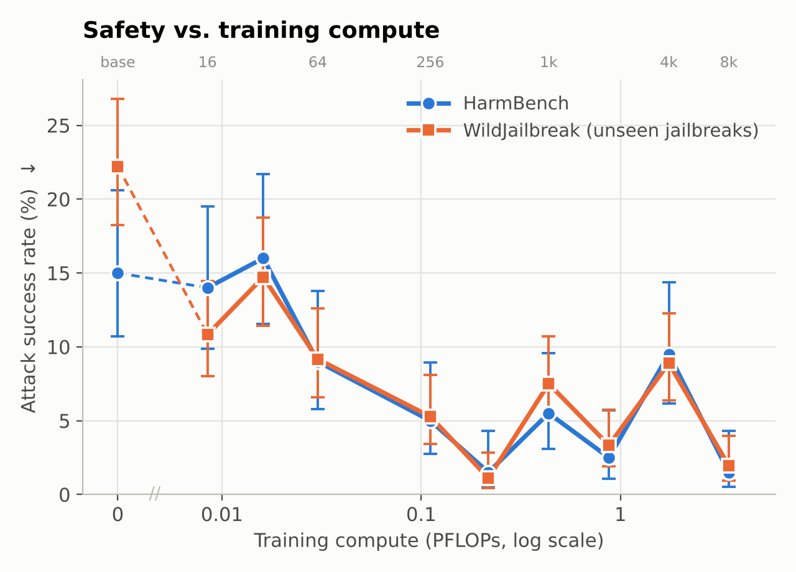
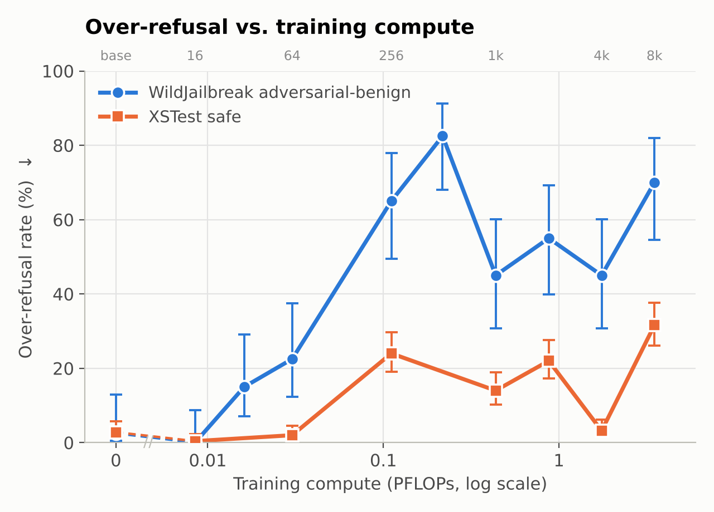
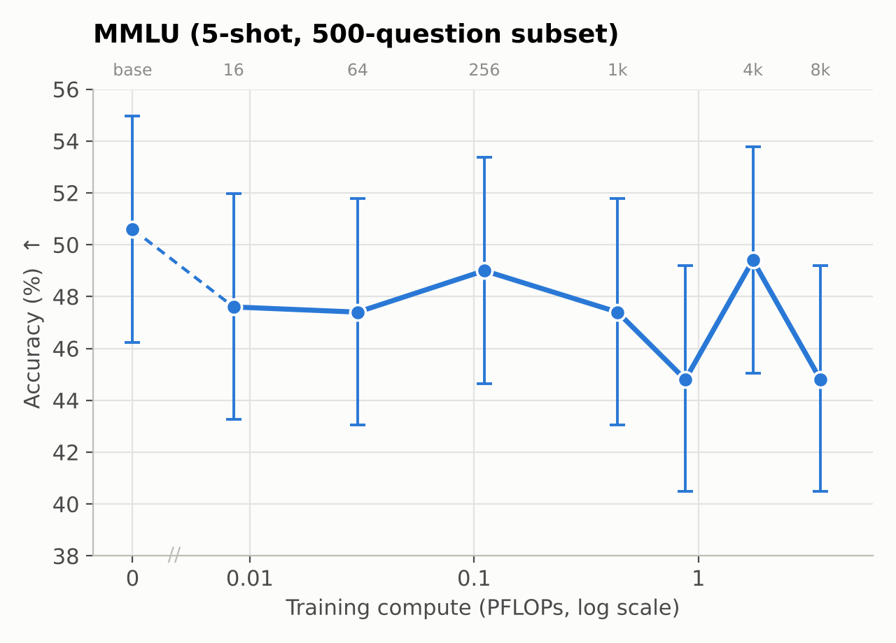
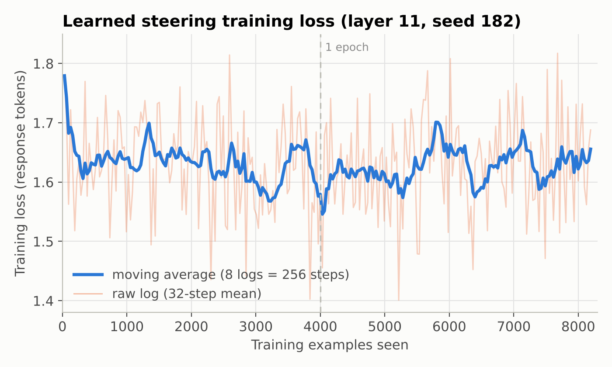

# Learned Activation Steering: Method and Experiments

### Method

Learned steering adapts a frozen language model by adding one trainable vector to its hidden states
instead of updating any model weights. Let $f_\theta$ be a frozen decoder-only language model with
$L$ layers and hidden size $d$, and let $h^{(\ell)}_t \in \mathbb{R}^d$ be the residual-stream output
of layer $\ell$ at position $t$. We learn a vector $v \in \mathbb{R}^d$ and add it at a fixed layer
$\ell^\star$ to every position, including generated tokens:

$$\tilde{h}^{(\ell^\star)}_t = h^{(\ell^\star)}_t + \alpha\, v, \qquad t = 1, \dots, T \qquad (1)$$

where $\alpha$ is an inference-time scale ($\alpha = 1$ during training). All model parameters
$\theta$ stay frozen, so $v$ is the only trainable quantity: $d = 1{,}024$ parameters for
Qwen3.5-0.8B.

We train $v$ on prompt–response pairs $(x, y)$ in which harmful requests are paired with refusals and
benign requests with helpful answers. The loss is the response-only negative log-likelihood of the
steered model,

$$\mathcal{L}(v) = -\,\mathbb{E}_{(x,y)}\Big[\frac{1}{|y|}\sum_{t=1}^{|y|} \log p_{\theta,v}\big(y_t \mid x, y_{<t}\big)\Big] \qquad (2)$$

which is the same supervised objective used for LoRA and soft prompt tuning. Because $v$ enters at
layer $\ell^\star$, gradients only need to propagate through the layers above it and the output head,
and no weight gradients are formed. $v$ is initialized to zero, so training starts from the base
model. Unlike difference-of-means (DoM) steering, which fixes $v$ to the mean activation difference
between harmful and harmless prompts, the direction is learned from the same objective that rewards
both refusing and helping. At inference time the vector is added by a forward hook, which costs one
vector addition per token and can be rescaled or removed without retraining.

### Experiments

**Setup.** We use Qwen3.5-0.8B with greedy decoding and thinking mode disabled, and steer at layer
$\ell^\star = 11$ (a full-attention layer near mid-depth, the same layer used for DoM). The training
set is the shared 4,000 WildJailbreak prompt–response pairs. Prompts keep their last 256 tokens and
responses their first 128. We train with AdamW (learning rate $10^{-2}$, no weight decay, gradient
clipping at 1.0) and batch size 1, so one step is one example. Training compute is counted
analytically per example as

$$C = \underbrace{2NT + 2dVR}_{\text{forward}} + \underbrace{2N_{>\ell^\star}T + 2dVR}_{\text{backward}} \qquad (3)$$

where $N$ is the number of non-embedding parameters, $N_{>\ell^\star}$ those above the steered layer,
$T$ the number of tokens, $R$ the number of response tokens and $V$ the vocabulary size. Since the
backward pass stops at layer 11, one example costs about 0.43 TFLOPs, so a 1,000-example budget
costs 0.44 PFLOPs, less than half of what soft prompt tuning needs for the same data.

**Preliminary run and rerun.** The run reported below trained for 8,192 steps (about two epochs) and
saved checkpoints at powers of two (16, 32, …, 8,192 examples). This does not line up with the
1,000 / 2,000 / 4,000-example budgets used by the other methods, so we will rerun learned steering
for one epoch and save checkpoints after 1,000, 2,000 and 4,000 examples. The rerun uses the
hyperparameter selection below, and its three checkpoints are evaluated on the same test sets, with
the same judge and metrics, as the other methods.

| Checkpoint | Examples seen | Tokens processed | Training compute |
|---|---|---|---|
| 1k | 1,024 | ≈0.22M | 0.44 PFLOPs |
| 2k | 2,048 | ≈0.43M | 0.87 PFLOPs |
| 4k | 4,096 | ≈0.86M | 1.75 PFLOPs |
| 8k | 8,192 | ≈1.73M | 3.50 PFLOPs |

*Table 1: Learned-steering checkpoints from the preliminary run closest to the shared budgets. The
rerun saves at exactly 1,000, 2,000 and 4,000 examples.*

**Hyperparameter selection.** In the preliminary run the training loss stops improving after about
250 examples, and later checkpoints swing between refusing more and complying more (see Results).
This points to the constant learning rate with batch size 1, so the rerun adds a cosine learning-rate
decay to zero over the epoch. We compare six configurations on the 400-prompt WildJailbreak
development split:

- injection layer $\ell^\star \in \{5, 11, 17\}$;
- peak learning rate $\in \{3 \times 10^{-3},\ 10^{-2}\}$.

Each configuration is scored at its 4,000-example checkpoint by
$\tfrac{1}{2}(\text{harmful ASR} + \text{benign refusal})$ on the development split, and the lowest
score is selected. We then choose the inference scale $\alpha \in \{0.5, 1, 2\}$ on the same split.
Test sets are evaluated only after both choices are fixed.

**Measurement.** Safety is the attack success rate on HarmBench and on the WildJailbreak evaluation
set. Over-refusal is the full-refusal rate on XSTest safe prompts and on WildJailbreak benign
prompts. General capability is MMLU accuracy. Responses are labeled by DeepSeek-V4.1-Flash using the
HarmBench classifier prompt for harmfulness and the XSTest prompt for refusal. The preliminary run
below was evaluated on fixed subsets (all 200 HarmBench behaviors, all 450 XSTest prompts, 400
WildJailbreak test prompts and 500 MMLU questions, five-shot), so its absolute numbers are not
directly comparable with Table 2 of the other methods.

**Results (preliminary run).** Figures 1–4 show safety, over-refusal and capability against training
compute on a log scale. The leftmost point in each plot is the base model.

*Figure 1: Attack success rate versus training compute. Lower is better.*

*Figure 2: Over-refusal rate on benign prompts versus training compute. Lower is better.*

*Figure 3: MMLU accuracy versus training compute. Higher is better.*

*Figure 4: Training loss on response tokens.*

As Figure 1 shows, a single 1,024-dimensional vector is enough to block most attacks. HarmBench
attack success falls from 15.0% to 5.0% after 256 examples (0.11 PFLOPs) and to 1.5% after 512;
WildJailbreak attack success on unseen jailbreaks falls from 22.2% to 1.1% at the same point. The
two benchmarks move together at every checkpoint. The curve is not monotonic: at 4,096 examples both
rates return to about 9% before falling to 1.5–1.9% at 8,192.

Figure 2 shows the cost. Full refusals of benign WildJailbreak prompts rise from 2.5% to 45–83% from
256 examples on, and full refusals of XSTest safe prompts rise from 2.8% to as much as 32%. The
checkpoints with the lowest attack success (512, 2,048, 8,192) are also the ones that refuse the most
benign prompts, while the 4,096 checkpoint refuses few benign prompts but complies with 21.5% of
XSTest unsafe prompts. The vector moves along one refuse-more / comply-more direction rather than
learning to separate harmful from benign requests.

MMLU stays within noise of the base model (50.6%) up to 1,024 examples, then drops to 44.8% at both
2,048 and 8,192 examples (paired McNemar $p = 0.002$) while the 4,096 checkpoint stays at 49.4%. The
capability drop follows the same checkpoints as the strongest refusal behavior.

Figure 4 explains the swings. The loss falls from 1.78 to about 1.63 within the first 250 examples
and then stays flat through both epochs, and the vector norm stops growing after about 500 examples.
Later checkpoints differ in direction rather than in fit, driven by the most recent examples, which
is what the learning-rate decay in the rerun addresses. The learned vector is nearly orthogonal to
the DoM direction at the same layer ($|\cos| \le 0.03$ from 256 examples on), so optimizing behavior
directly finds a different direction from the mean activation difference.

**Limitations.** Results come from a single training seed, and the LLM judge has not been validated
against human labels. The compute figures are analytic estimates. Experiments on hyperparameter selection and more random seeds are running.

### Appendix

| Checkpoint | PFLOPs | HarmBench ASR | WJ ASR | XSTest-unsafe ASR | WJ benign over-refusal | XSTest-safe over-refusal | MMLU |
|---|---|---|---|---|---|---|---|
| Base | 0 | 15.0 | 22.2 | 2.5 | 2.5 | 2.8 | 50.6 |
| 16 | 0.008 | 14.0 | 10.8 | 20.5 | 0.0 | 0.4 | 47.6 |
| 32 | 0.016 | 16.0 | 14.7 | — | 15.0 | — | — |
| 64 | 0.030 | 9.0 | 9.2 | 11.5 | 22.5 | 2.0 | 47.4 |
| 256 | 0.111 | 5.0 | 5.3 | 2.5 | 65.0 | 24.0 | 49.0 |
| 512 | 0.217 | 1.5 | 1.1 | — | 82.5 | — | — |
| 1,024 | 0.436 | 5.5 | 7.5 | 12.5 | 45.0 | 14.0 | 47.4 |
| 2,048 | 0.875 | 2.5 | 3.3 | 10.0 | 55.0 | 22.0 | 44.8 |
| 4,096 | 1.750 | 9.5 | 8.9 | 21.5 | 45.0 | 3.2 | 49.4 |
| 8,192 | 3.499 | 1.5 | 1.9 | 1.5 | 70.0 | 31.6 | 44.8 |

*Table 2: Preliminary learned-steering results (layer 11, α = 1, seed 182) on the evaluation subsets.
All values are percentages. WJ denotes the WildJailbreak evaluation set; n = 360 harmful and 40 benign
prompts. Over-refusal counts full refusals. "—": evaluation still running. ASR and over-refusal:
lower is better; MMLU: higher is better.*
