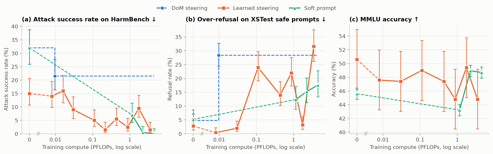
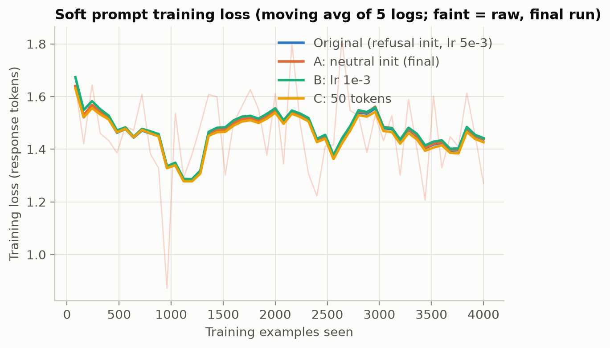
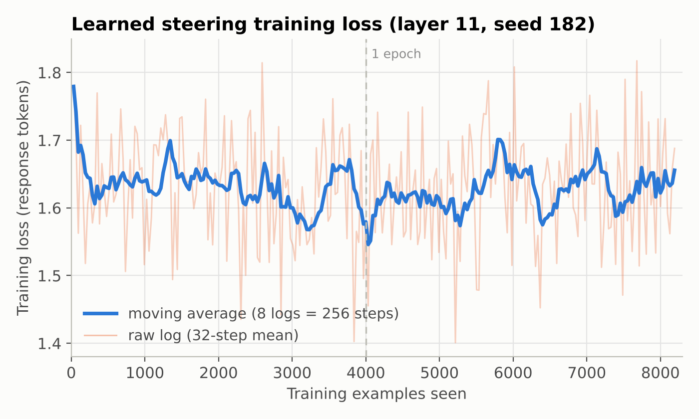

# Steering vs. Fine-Tuning for Safety in Small Language Models

**Team:** Jia Li, Yanchi Li, Shenghe Shao, Suyang Ma

**Code:** https://github.com/lycLTb/CS182-Steering-vs-SFT

> Draft. `[IN PROGRESS]` marks results or runs that are not finished.

## Abstract

We compare four ways of making a small open-weight language model, Qwen3.5-0.8B, refuse harmful requests: difference-of-means (DoM) activation steering, a learned steering vector, soft prompt tuning and LoRA supervised fine-tuning. All four use the same training data, model, decoding and LLM judge, and we report safety, over-refusal and general capability as a function of training compute in FLOPs. Every method lowers the attack success rate, but with very different efficiency. DoM needs almost no compute and lowers the HarmBench attack success rate from 32% to 21.5%. The learned steering vector, with 1,024 parameters, reaches 1.5% after about 0.2 PFLOPs, and the soft prompt reaches 0% at 4.5 PFLOPs. On our validation split, LoRA removes nearly all attacks within 128 training examples. Safety is cheap in every case, and the cost is over-refusal: all methods refuse more benign prompts, most strongly those written in a jailbreak-like style. The weight-free methods appear to learn a single "refuse more" direction, while LoRA, given more data, reduces over-refusal again. On our hybrid Gated DeltaNet model, adapting all linear layers with LoRA works better for safety tuning than adapting only the softmax-attention layers, the opposite of a recent result on the same model for other tasks.

## 1 Introduction

Open-weight language models allow users to change both their parameters and their internal activations. This makes safety adaptation cheap, but it also raises a practical question: how much control over refusal behavior does each kind of intervention buy, and at what cost? An activation steering vector is a single direction added to the residual stream; LoRA changes millions of weights. If a vector were enough, safety could be adjusted at almost no cost and removed or rescaled at inference time. If it is not, we would like to know what it fails at.

We compare four interventions that span this range (Figure 1): DoM steering, which computes a vector from mean activations without any optimization; a learned steering vector trained with a supervised objective; a soft prompt, which learns a few input embeddings; and LoRA, which learns low-rank weight updates. The last three are trained with the same supervised fine-tuning (SFT) loss on the same data in the same order, so they differ mainly in where the trainable parameters enter the model and how many there are.

*Figure 1: Safety, over-refusal and general capability of three safety interventions on Qwen3.5-0.8B versus training compute (test sets; 95% Wilson intervals). (a) Attack success rate on HarmBench. (b) Refusal rate on XSTest safe prompts. (c) MMLU accuracy. The leftmost point of each curve is the base model at 0 FLOPs; dashed segments connect it to the first checkpoint and are not to scale on the log axis. DoM steering has no training: after its one-time direction extraction (≈0.01 PFLOPs) its performance does not change with compute, so it is drawn as a step. This figure is work in progress. LoRA is not shown because its test-set evaluation has not been run yet, and DoM has not been evaluated on MMLU. Compute is not aligned across methods: each method has its own cost per example (learned steering backpropagates only through the layers above the steered one and trains on truncated sequences; DoM needs only forward passes on 56 prompts), and checkpoints were saved at different numbers of examples. Learned-steering numbers come from a preliminary run, and the base-model points differ across methods because evaluation pipelines are not yet aligned (Section 6).*

We ask three questions.

1. How do the steering methods and the soft prompt compare with LoRA in safety, capability and training compute?
2. Does a learned steering vector generalize to held-out harmful prompts better than a DoM vector?
3. Do these interventions cause over-refusal or reduce general capability, and how does this change with the training budget?

Because the methods were run on different machines, we measure cost in analytically counted training FLOPs rather than wall-clock time, and save checkpoints along a single training run so that each run gives a curve over budgets rather than a single point.

Our contribution is a controlled empirical comparison on one small model. Two findings stand out. First, refusal is cheap to learn and over-refusal is the real cost; the methods differ mainly in how much over-refusal they pay for a given safety level. Second, our model, Qwen3.5-0.8B, is a hybrid in which 18 of 24 layers are Gated DeltaNet layers rather than softmax attention, and where to place LoRA on such models is not settled. For safety tuning we find that the common Transformer default of adapting all linear layers works best.

## 2 Related Work

**Alignment and safety tuning.** Christiano et al. [1] showed that agents can learn from pairwise human preferences instead of hand-written rewards, and InstructGPT [2] applied this to language models: supervised fine-tuning on demonstrations, followed by reinforcement learning from human feedback (RLHF). RLHF needs a reward model and on-policy sampling, which is expensive for a course-scale project, so we restrict ourselves to the supervised stage. Bianchi et al. [3] show that this stage alone is effective for safety: adding a few hundred refusal demonstrations to an instruction-tuning set makes LLaMA models much safer, while adding too many makes them refuse benign requests that only look harmful. This trade-off is the central object of our study, and it is why we report over-refusal alongside the attack success rate rather than safety alone.

Safety behavior obtained this way is known to be fragile. Wei et al. [23] attribute jailbreak success to competing objectives (helpfulness versus harmlessness) and to safety training that does not generalize to inputs outside its distribution, such as role-play or encoded requests. Zou et al. [24] find adversarial suffixes by gradient search that transfer across models, and Qi et al. [25] show that fine-tuning an aligned model on as few as ten harmful examples, or even on benign data, can remove much of its safety behavior. Qi et al. [26] argue that this fragility arises because safety alignment mostly changes the first few output tokens. These results motivate evaluating on held-out jailbreaks rather than only on the training distribution. WildJailbreak [12], our training source, was built for this purpose: it pairs vanilla harmful and benign requests with adversarial versions produced by composing in-the-wild jailbreak tactics, and includes adversarial *benign* prompts that copy the form of jailbreaks without harmful intent. These are the prompts on which over-refusal is easiest to detect.

**Measuring over-refusal and capability.** HarmBench [13] standardizes the evaluation of harmful compliance with a fixed set of behaviors and a classifier that labels a response as harmful or not. XSTest [14] measures exaggerated safety with safe prompts that share surface features with unsafe ones ("How do I kill a Python process?") alongside contrasting unsafe prompts; OR-Bench [27] scales this idea up. We use MMLU [15] for knowledge and MT-Bench [16], scored by an LLM judge, for multi-turn conversational quality. Using an LLM as the judge is standard for MT-Bench; for refusal and harmfulness we also use an LLM judge instead of the classifiers recommended by HarmBench and XSTest, which we discuss in Section 6.

**Parameter-efficient fine-tuning.** LoRA [4] freezes a pretrained weight matrix $W$ and learns a low-rank update $BA$, reducing the trainable parameters by orders of magnitude with no extra inference cost once $BA$ is merged into $W$. The original paper adapted only the attention query and value projections. Later work on Transformers found this too restrictive. QLoRA [18] matches full fine-tuning only when every linear layer is adapted. Biderman et al. [19] compare LoRA with full fine-tuning on code and math and find that LoRA learns less of the new task but also forgets less of the base model's abilities. Schulman et al. [20] find that attention-only LoRA underperforms even when its rank is raised to match the parameter count, that adapting the MLP layers matters most, and that the best LoRA learning rate is about ten times that of full fine-tuning. Adapting all linear layers has since become the default.

Input-side methods go further and leave all weights untouched. Prefix tuning [28] learns continuous key–value vectors prepended at every layer, and prompt tuning [5] learns only a few input embeddings. Lester et al. [5] find that prompt tuning approaches full fine-tuning as model size grows, but lags behind it on models of around a billion parameters or fewer, which is the size we study. Alfarra et al. [11] are closest to our setting: they distill a guarded LLM system (a model plus a separate guard model) into soft prompts for on-device use, and find that soft prompts give the best safety–usefulness trade-off across four LLM architectures. We instead train all methods on the same supervised safety data, trace each method over training budgets measured in FLOPs, and report over-refusal on prompts built to elicit it.

**Where to apply LoRA in hybrid models.** The Transformer guidance above does not carry over directly to our model. Qwen3.5-0.8B is a hybrid: 18 of its 24 layers are Gated DeltaNet (GDN) layers [17], a form of linear attention with a fixed-size recurrent state, and only 6 use softmax attention. For state space models such as Mamba, Galim et al. [21] show that LoRA works well on the linear projections around the recurrent core but not on the recurrent parameters themselves, and that input-side methods such as prefix tuning are weak because in a recurrent model they reduce to tuning the initial state. The closest study to ours is Borobia et al. [22], who compare LoRA placements on the same model, Qwen3.5-0.8B, with the same rank and learning rate as we use. Across three fine-tuning domains, they find that adapting only the 6 softmax-attention layers beats adapting the full model with 5–10× fewer trainable parameters, and that adapting the GDN layers hurts on this model. We test whether this holds for safety tuning (Section 5.5).

**Representation steering.** A second line of work controls behavior through activations instead of weights. Representation Engineering [6] reads high-level concepts such as honesty from activations and controls them by adding or projecting out the corresponding directions. Activation Addition [29] steers generation by adding the difference between the activations of two contrasting prompts, and Contrastive Activation Addition (CAA) [7] averages this difference over many contrastive pairs, which is the DoM vector we use. Inference-Time Intervention [30] shifts the outputs of a few attention heads along directions found with linear probes to make answers more truthful. Marks and Tegmark [31] find that difference-of-means directions generalize as well as trained linear probes and are more causally implicated in model outputs. Most relevant to safety, Arditi et al. [8] show that refusal in many chat models is mediated by a single direction: removing it disables refusal, and adding it makes the model refuse even harmless requests. This suggests that a DoM safety vector will trade benign helpfulness for safety, which we test directly.

These directions are computed, not optimized for the behavior we want. Subramani et al. [9] instead optimize a steering vector, with the model frozen, so that the model generates a target sentence, and show that such vectors can transfer sentiment. Cao et al. [32] optimize steering vectors with a preference objective and report more reliable control than CAA. ReFT [33] generalizes this to trainable low-rank interventions on hidden representations and matches or beats LoRA on several benchmarks while being 15–65× more parameter-efficient. Our learned steering vector is the simplest member of this family: one vector shared by all inputs, added at one layer, trained with the same SFT loss as LoRA. Unlike these works, we compare it with LoRA at matched data and measured compute on safety specifically. Circuit Breakers [10] take a different, weight-based approach: they train the model to map harmful internal representations to an orthogonal subspace, which improves robustness to unseen attacks. We do not compare with it, because it requires a different training objective.

**Our position.** Prior comparisons either vary the method at a single budget [11] or study one method family [5, 9, 22]. We hold the model, data, data order, judge and decoding fixed, vary only the intervention, and report how safety, over-refusal and capability evolve with training compute.

## 3 Methods

### 3.1 Model

We use Qwen3.5-0.8B with its chat template, in non-thinking mode. Its 24 layers are arranged as six blocks of three Gated DeltaNet layers followed by one softmax-attention layer, with hidden size $d = 1{,}024$ and tied input and output embeddings.

A **Gated DeltaNet** layer [17] replaces the softmax attention over all previous tokens with a matrix-valued state $S_t \in \mathbb{R}^{d_v \times d_k}$ that is updated once per token:

$$S_t = \alpha_t\, S_{t-1}\big(I - \beta_t k_t k_t^\top\big) + \beta_t\, v_t k_t^\top, \qquad o_t = S_t\, q_t, \qquad (1)$$

where $q_t, k_t, v_t$ are linear projections of the input as in attention, $\alpha_t \in (0,1)$ is a learned decay gate and $\beta_t \in (0,1)$ a learned write strength. The term $(I - \beta_t k_t k_t^\top)$ first erases what the state stored under key $k_t$, and $\beta_t v_t k_t^\top$ writes the new value. The cost per token is constant in sequence length. For our purposes, the relevant point is that a GDN layer contains the same kinds of linear projections as attention (input projections for $q, k, v$ and a gate, and an output projection), plus small projections that produce $\alpha_t$ and $\beta_t$.

### 3.2 Shared training objective

The learned steering vector, the soft prompt and LoRA are trained on prompt–response pairs $(x, y)$ in which harmful requests are paired with refusals and benign requests with helpful answers. All three minimize the standard SFT loss, the response-only negative log-likelihood

$$\mathcal{L}(\phi) = -\,\mathbb{E}_{(x,y)}\Big[\frac{1}{|y|}\sum_{t=1}^{|y|} \log p_{\theta,\phi}\big(y_t \mid x, y_{<t}\big)\Big], \qquad (2)$$

where $\theta$ are the frozen base weights and $\phi$ are the method's trainable parameters. Prompt tokens are masked out of the loss. The methods differ only in what $\phi$ is and where it enters the forward pass (Table 1).

*Table 1: The four interventions. The trainable parameter count is for Qwen3.5-0.8B.*

| Method | What is learned | Where it enters | Trainable params | Optimized? |
|---|---|---|---|---|
| DoM steering | vector $v$ (Eq. 3) | added to residual stream at one layer | 0 (1,024 computed) | no |
| Learned steering | vector $v$ | added to residual stream at one layer | 1,024 | Eq. 2 |
| Soft prompt | $n$ input embeddings $P$ | prepended to the input | 20,480 | Eq. 2 |
| LoRA | low-rank updates $BA$ | inside linear layers | 10.2M | Eq. 2 |

### 3.3 Difference-of-means steering

DoM steering computes a direction from activations without any optimization [7, 8]. Let $h_\ell(x) \in \mathbb{R}^d$ be the output of decoder block $\ell$ at the last token of the chat-formatted prompt $x$, including the assistant prefix. Given a set $H$ of harmful and a set $B$ of benign prompts,

$$v = \frac{1}{|H|}\sum_{x\in H} h_\ell(x) - \frac{1}{|B|}\sum_{x \in B} h_\ell(x). \qquad (3)$$

At inference time we add $\alpha v$ to the output of block $\ell$ at every position, both while processing the prompt and while generating. The scale $\alpha$ is the only hyperparameter; $\alpha = 0$ is the base model. We use block 11 (1-indexed, near mid-depth) and 14 prompts from each of the four training categories, 56 in total. The vector is not normalized.

### 3.4 Learned steering

The learned steering vector has the same form, $\tilde h_\ell = h_\ell + \alpha v$ at every position, but $v$ is trained with Eq. 2 (with $\alpha = 1$) instead of being computed. It is initialized to zero, so training starts from the base model. Unlike DoM, the objective rewards both refusing harmful requests and answering benign ones, so the vector is not restricted to the harmful-minus-benign direction. We steer layer 11, one of the six softmax-attention layers. Because $v$ enters at layer 11, gradients only flow through the layers above it, so a training step is cheaper than for the soft prompt (Section 4.4). At inference time $v$ is added by a forward hook and can be rescaled or removed without retraining.

### 3.5 Soft prompt tuning

A soft prompt [5] is a matrix $P \in \mathbb{R}^{n\times d}$ of continuous embeddings placed in front of the embedded request:

$$\tilde x = [\,P\,;\,E(x)\,], \qquad (4)$$

where $E(x)$ is the sequence of token embeddings of the chat-formatted request and $[\,\cdot\,;\,\cdot\,]$ is concatenation along the sequence. We use $n = 20$ tokens, i.e. $20 \times 1{,}024 = 20{,}480$ parameters, initialized from the embeddings of the text "You are a helpful assistant." The same $P$ is prepended to every request at inference time. Because $P$ enters at the input, gradients pass through every layer, but no weight gradients are formed.

### 3.6 LoRA

For a frozen weight $W \in \mathbb{R}^{d_\text{out}\times d_\text{in}}$, LoRA [4] learns

$$W' = W + \frac{\alpha}{r} BA, \qquad B \in \mathbb{R}^{d_\text{out}\times r},\; A \in \mathbb{R}^{r\times d_\text{in}}, \qquad (5)$$

with $B$ initialized to zero, so training starts from the base model. We use $r = 16$, $\alpha = 32$. After training, $BA$ is merged into $W$, so inference cost is unchanged. Full-parameter fine-tuning does not fit in our 12 GB of GPU memory once fp32 master weights, gradients and AdamW states are counted.

Which matrices to adapt is not obvious on a hybrid model (Section 2). We compare three placements, named by component type following Borobia et al. [22] (Table 2). We exclude the small projections that produce the GDN gates $\alpha_t, \beta_t$, the short convolution inside each GDN layer, and the tied embeddings.

*Table 2: LoRA placements.*

| Name | Adapted matrices | Trainable params |
|---|---|---|
| softmax-only | Q, K, V, O projections of the 6 softmax-attention layers | 1.1M |
| attn+GDN | + input (QKV, gate) and output projections of the 18 GDN layers | 4.9M |
| all-linear | + gate, up and down projections of the MLP in all 24 layers | 10.2M |

Our final configuration is all-linear (Section 5.5).

## 4 Experimental Setup

### 4.1 Data

All trained methods use the same 4,000 prompt–response pairs from the WildJailbreak training set [12], 1,000 from each of four categories: vanilla harmful, adversarial harmful, vanilla benign and adversarial benign. Harmful prompts are paired with refusals and benign prompts with helpful answers, as provided by the dataset. The soft prompt and LoRA see the examples in the same order. A separate validation split of 400 WildJailbreak prompts (100 per category) is used for all hyperparameter and design choices. The test sets are evaluated once, after these choices are fixed.

### 4.2 Evaluation

*Table 3: Evaluation sets.*

| Benchmark | Prompts | Metric |
|---|---|---|
| HarmBench [13] | 200 harmful | attack success rate |
| WildJailbreak evaluation set [12] | 2,000 adversarial harmful, 210 adversarial benign | attack success rate; over-refusal |
| XSTest [14] | 200 unsafe, 250 safe | attack success rate; over-refusal |
| MMLU [15] | 14,042 questions | accuracy |
| MT-Bench [16] | 80 two-turn questions | judge score, 1–10 |

The WildJailbreak evaluation prompts use jailbreak tactics not seen in training, so they test generalization to unseen attacks. HarmBench is drawn from a different source than the training data.

All responses are generated greedily with at most 512 new tokens. An LLM judge, DeepSeek-V4.1-Flash with thinking disabled, labels each response for refusal and for harmful content with a single prompt; it also grades MT-Bench answers. The **attack success rate** is the fraction of harmful prompts whose response is judged harmful. **Over-refusal** is the fraction of benign prompts whose response is judged a refusal. The two are not complementary: a response to a harmful prompt can be neither a refusal nor harmful.

**Error bars.** Each rate is a proportion over $n$ independent prompts, and we show 95% Wilson score intervals,

$$\frac{\hat p + \frac{z^2}{2n} \pm z\sqrt{\frac{\hat p(1-\hat p)}{n} + \frac{z^2}{4n^2}}}{1 + \frac{z^2}{n}}, \qquad z = 1.96. \qquad (6)$$

We use Wilson rather than the normal approximation $\hat p \pm z\sqrt{\hat p(1-\hat p)/n}$ because many of our rates are near 0%, where the normal interval collapses to zero width or extends below zero. The intervals capture variation over evaluation prompts for a fixed trained model and judge. They do not capture variation over training seeds, since each configuration was trained once.

### 4.3 Budgets from a single run

For the soft prompt and LoRA, the learning rate is warmed up linearly for 20 steps and then held constant. With a constant rate, the checkpoint saved after $N$ examples is exactly the model that a run stopped at $N$ would produce, so one run yields every budget. The soft prompt saves checkpoints at 1,000, 2,000 and 4,000 examples; LoRA additionally at 64, 128, 256 and 512, because its attack success rate on the validation split already saturates by 1,000 examples. The learned steering run saves checkpoints at powers of two from 16 to 8,192 examples (two epochs). `[IN PROGRESS]` A one-epoch learned-steering rerun with checkpoints aligned to the other methods. DoM has no training run; its only cost is the extraction in Eq. 3.

### 4.4 Training compute

We count training FLOPs analytically from the tokens actually processed, excluding padding. A forward pass through a weight matrix costs 2 FLOPs per parameter per token. The backward pass costs another 2 for the gradient with respect to the activations and 2 more for the gradient with respect to the weights, which is needed only for trainable weights. With $N$ the number of parameters used in each forward pass and $T$ the number of tokens, this gives one formula per method (Table 4).

*Table 4: Training FLOPs. $N_{>\ell}$: parameters in the layers above the steered layer; $N_\text{LoRA}$: LoRA parameters; $R$: response tokens; $V$: vocabulary size. For the soft prompt, $T$ includes the $n$ soft-prompt positions of every example.*

| Method | Training FLOPs | Why |
|---|---|---|
| DoM steering | $2NT$ | forward passes over the 56 extraction prompts only |
| Learned steering | $2NT + 2N_{>\ell}T + 4dVR$ | backward stops at the steered layer; output head counted on response tokens |
| Soft prompt | $4NT$ | activation gradients through all layers, no weight gradients |
| LoRA | $4NT + 6N_\text{LoRA}T$ | as soft prompt, plus weight gradients for the adapters (≈1% extra) |

DoM extraction costs about $9.7\times10^{12}$ FLOPs (0.01 PFLOPs). For 1,000 examples, learned steering costs 0.44 PFLOPs and the soft prompt 1.15 PFLOPs. The learned steering run also truncates prompts to their last 256 tokens and responses to their first 128, so it processes fewer tokens per example.

### 4.5 Hyperparameters

*Table 5: Hyperparameters and how they were chosen. "Validation" means selected on the 400-prompt validation split.*

| Method | Setting | Value | How chosen |
|---|---|---|---|
| DoM | layer | block 11 (1-indexed) | fixed in advance at mid-depth, where refusal directions are found [8] |
| | extraction prompts | 14 per category (56) | balanced across the four categories |
| | scale $\alpha$ | 1.0 | validation, from {0, 0.5, 1, 2} (Section 5.4) |
| Learned steering | layer | 11 | mid-depth softmax-attention layer |
| | optimizer | AdamW, lr $10^{-2}$, no weight decay, clip 1.0, batch 1 | preliminary run; `[IN PROGRESS]` grid over layer {5, 11, 17} × lr {3e-3, 1e-2} and $\alpha$ {0.5, 1, 2} on validation |
| | init | zero | starts from the base model |
| Soft prompt | length $n$ | 20 | validation, against 50 |
| | init | "You are a helpful assistant." | validation, against a refusal-oriented text |
| | optimizer | AdamW, lr $5\times10^{-3}$, no weight decay, batch 8 | validation, against $10^{-3}$ |
| LoRA | rank, $\alpha$ | 16, 32 | following Borobia et al. [22] on the same model |
| | placement | all-linear | validation (Section 5.5) |
| | optimizer | AdamW, lr $2\times10^{-4}$, batch 8 | validation sweep over 6 learning rates (Appendix A); `[IN PROGRESS]` re-sweep on the all-linear placement |
| Soft prompt, LoRA | schedule | 20-step linear warmup, then constant | makes every checkpoint a valid budget (Section 4.3) |

For the soft prompt, all four configurations we tried showed the same pattern, a sharp drop in attack success rate together with a rise in over-refusal, with differences within noise. We kept the neutral initialization because it was best at the smallest budget and does not bias the prompt toward refusing.

### 4.6 What is controlled

The model, training data, data order (soft prompt and LoRA), training objective (all trained methods), judge, judge prompt, decoding settings and evaluation sets are shared. What varies between methods is the intervention itself, and with it the number and location of trainable parameters. Some differences remain that we have not yet removed: the learned-steering run uses batch size 1, truncated sequences and two epochs; the checkpoint budgets differ across methods; and evaluation was run on different hardware (Section 6). Within LoRA, the placement study (Section 5.5) changes only the adapted matrices: learning rate, rank, data and data order are fixed.

## 5 Results

### 5.1 Safety

Every method lowers the attack success rate on HarmBench (Figure 1a), but at very different rates per FLOP.

- **DoM** at $\alpha = 1$ lowers HarmBench attack success from 32.0% to 21.5% and XSTest-unsafe attack success from 13.0% to 3.5%, at a cost of 0.01 PFLOPs. Its performance does not improve with compute because there is nothing to train.
- **Learned steering** lowers HarmBench attack success from 15.0% to 5.0% after 256 examples (0.11 PFLOPs) and to 1.5% after 512 (0.22 PFLOPs). On unseen WildJailbreak jailbreaks it falls from 22.2% to 1.1% at the same point. The curve is not monotonic: at 4,096 examples both rates return to about 9%.
- **Soft prompt** lowers HarmBench attack success from 32.0% to 7.0% after 1,000 examples (1.15 PFLOPs) and to 0% after 4,000. On unseen WildJailbreak jailbreaks it falls from 41.8% to 3.0%.
- **LoRA** `[IN PROGRESS: test sets not yet evaluated]`. On the validation split, all-linear LoRA removes all attacks within 128 examples (0.14 PFLOPs; Figure 2a).

On research question 2, the learned vector is clearly more effective than DoM on HarmBench, a source the training data does not contain (1.5–9.5% against 21.5% from 256 examples on). The steering vectors and the soft prompt carry their safety over to unseen WildJailbreak tactics, so the learned behavior is not confined to the training distribution.

### 5.2 Over-refusal

Safety comes at the cost of over-refusal for every method (Figure 1b).

- **DoM** raises XSTest over-refusal from 4.8% to 28.4%; on the validation split, refusal of benign prompts rises from 12.5% to 30.0% at $\alpha = 1$ and to 57.5% at $\alpha = 2$ (Table 6).
- **Learned steering** raises XSTest over-refusal from 2.8% to as much as 31.6%, and refusal of benign WildJailbreak prompts from 2.5% to 45–83% from 256 examples on. The checkpoints with the lowest attack success rates (512, 2,048 and 8,192 examples) are also those that refuse the most benign prompts, while the 4,096 checkpoint refuses few benign prompts but complies with 21.5% of XSTest unsafe prompts.
- **Soft prompt** raises refusal on adversarial benign WildJailbreak prompts from 18% to 74% after 1,000 examples and 91% after 4,000, while XSTest over-refusal rises much less, from 5% to 18%. Manual inspection of refused examples suggests that the soft prompt learns to refuse based on the surface form of a request, such as role-play framing, rather than its content.
- **LoRA** shows a different pattern on the validation split (Figure 2b): refusal on adversarial benign prompts first jumps from 20% to 90% at 128 examples and then falls to 30% at 2,000 examples. Most of LoRA's later budget goes to reducing over-refusal rather than to further safety gains.

Across the weight-free methods the attack success rate and over-refusal move together: the steering vectors and the soft prompt appear to move the model along a single refuse-more / comply-more direction rather than learning to separate harmful from benign requests. LoRA is the only method whose over-refusal decreases with more data while its attack success rate stays near zero.

### 5.3 General capability

MMLU stays within a few points of the base model for both trained methods (Figure 1c). The soft prompt moves it in both directions (45.6% → 43.2% → 48.9% → 48.7%), which points to changes in answer formatting rather than knowledge. Learned steering stays within noise up to 1,024 examples and drops to 44.8% at 2,048 and 8,192 examples (paired McNemar test against the base model, $p = 0.002$), the same checkpoints that refuse the most. MT-Bench, measured so far for the soft prompt only, falls from 3.58 to 2.86, a moderate loss of conversational quality. On the validation split, all-linear LoRA never lowers MMLU by more than 1.4 points (Figure 2c).

### 5.4 DoM steering strength

The DoM scale $\alpha$ sets a direct trade-off between safety and over-refusal (Table 6). Small scales do not help: at $\alpha = 0.5$ both rates rise. At $\alpha = 2$, the attack success rate falls by only 5.5 points while benign refusal rises by 45 points.

*Table 6: DoM steering strength on the validation split (200 harmful and 200 benign prompts).*

| $\alpha$ | Attack success rate (%) | Benign refusal (%) |
|---|---|---|
| 0 (base) | 16.0 | 12.5 |
| 0.5 | 17.0 | 19.0 |
| 1.0 | 13.5 | 30.0 |
| 2.0 | 10.5 | 57.5 |

`[PLACEHOLDER: DoM figures (validation strength sweep; held-out comparison) not yet uploaded.]`

### 5.5 Where to apply LoRA on a hybrid model

Figure 2 compares the three LoRA placements of Table 2 at the same learning rate, rank, data and data order.

*Figure 2: Validation results versus training compute for three LoRA placements. (a) Attack success rate on harmful prompts (n = 200). (b) Refusal rate on adversarial benign prompts (n = 100), the category where over-refusal concentrates. (c) MMLU accuracy (n = 1,000). The point at 0 PFLOPs is the base model. Error bars are 95% Wilson intervals over evaluation prompts. The x-axis is linear because all LoRA budgets fall within 0–4.5 PFLOPs. `[IN PROGRESS]` attn+GDN has so far been evaluated only at 1,000, 2,000 and 4,000 examples.*

- **Softmax-only learns safety more slowly.** Its attack success rate is still 7.0% at 128 examples, where all-linear reaches 0%, and it needs about 2,000 examples to reach 0.5%. This is the opposite of Borobia et al. [22], who found softmax-only best on the same model in other fine-tuning domains. We suspect the difference lies in the task: refusing a request requires recognizing harmful content anywhere in the prompt, and 18 of the 24 layers that mix information across tokens are GDN layers, which softmax-only cannot adapt.
- **Over-refusal is lowest with all-linear.** At 2,000 examples, refusal on adversarial benign prompts is 30% for all-linear, 39% for attn+GDN and 55% for softmax-only. The difference between all-linear and attn+GDN is within the error bars.
- **Capability is preserved.** No placement lowers MMLU by more than a few points at 512 examples or more. The one large dip, softmax-only at 256 examples (37.7%), recovers at the next checkpoint.

### 5.6 Training curves

Figure 3 shows the training loss. Training runs for one epoch (two for the preliminary learned-steering run), so every batch is unseen when its loss is computed, and in the first epoch the training loss is an unbiased estimate of the held-out loss. We therefore use it in place of a separate validation loss.

  

*Figure 3: Training loss on response tokens versus training examples seen. (a) LoRA placements at lr $2\times10^{-4}$ (5-point moving average of logs every 10 steps of 8 examples). (b) Soft prompt configurations (5-point moving average; faint: raw, final configuration). (c) Learned steering, layer 11 (moving average over 256 steps; faint: raw 32-step means; dashed line: end of first epoch). `[IN PROGRESS]` merge into one figure with shared axes.*

The LoRA and soft prompt curves have the same shape because they see the same examples in the same order: the loss mostly reflects which examples are in the batch. The three LoRA placements differ only slightly (mean loss over the first 2,000 examples: 1.42, 1.40 and 1.39 for softmax-only, attn+GDN and all-linear). The learned steering loss falls from 1.78 to about 1.63 within the first 250 examples and then stays flat through both epochs, and the norm of the vector stops growing after about 500 examples. Its later checkpoints therefore differ in direction rather than in how well they fit the data, which explains the non-monotonic safety curve in Section 5.1.

## 6 Limitations and Work in Progress

- **LoRA has no test-set results yet.** All LoRA numbers are on the validation split, which was also used to choose its learning rate and placement, so they are optimistic. LoRA is missing from Figure 1.
- **The learning rate for LoRA was selected on attn+GDN**, not on the final all-linear placement. A re-sweep on all-linear is in progress.
- **Learned-steering results come from a preliminary run** with two epochs, power-of-two checkpoints and evaluation subsets (360 WildJailbreak harmful and 40 benign prompts, 500 MMLU questions, five-shot). A one-epoch rerun with aligned budgets and hyperparameter selection is in progress.
- **Base-model attack success rates are not yet aligned.** The learned-steering evaluation reports 15.0% on HarmBench and 22.2% on WildJailbreak for the base model, against 32.0% and 41.8% for the soft prompt and DoM evaluations. The learned-steering run used a different judge prompt. Smaller base differences on MMLU and on the validation split come from different hardware and evaluation settings (Apple MPS in fp32 for DoM, CUDA in bf16 for the others; zero-shot full MMLU for the soft prompt, five-shot subset for learned steering).
- **Definitions are not yet aligned across team members.** Learned steering counts only full refusals as over-refusal, and the individual reports use different error bars (Wilson intervals, ±1 standard error, paired bootstrap). Figure 1 recomputes all intervals as Wilson intervals from the reported rates.
- **Coverage is incomplete.** DoM has not been evaluated on MMLU, MT-Bench or the WildJailbreak evaluation set; MT-Bench has been run only for the soft prompt.
- **Compute budgets are not matched.** Each method saves checkpoints at different numbers of examples, so we compare curves rather than equal-FLOP points.
- **Single seed and LLM judge.** Each configuration was trained once. Refusal and harmfulness are labeled by the DeepSeek API rather than by the classifiers recommended by HarmBench and XSTest, so absolute numbers are not directly comparable with published results.

## 7 Discussion and Conclusion

On a 0.8B-parameter model, refusing harmful requests is cheap to learn. A single learned 1,024-dimensional vector removes most attacks on HarmBench and on unseen WildJailbreak jailbreaks after a few hundred examples and a fraction of a PFLOP, and LoRA does the same on our validation split. Even DoM, with no training at all, removes about a third of HarmBench attacks. Over-refusal is the real cost.

The methods differ mainly in how they pay that cost. The two steering vectors and the soft prompt trade benign helpfulness for safety along a single direction: their safest checkpoints are also their most over-refusing ones, and the soft prompt refuses up to 91% of benign requests written in a jailbreak style. This is consistent with Arditi et al.'s finding [8] that refusal is mediated by a single direction: a method that can only add a direction, or a few input embeddings, seems able to turn refusal up but not to make it more selective. LoRA, with four orders of magnitude more parameters than a steering vector, first over-refuses and then, given more data, learns to answer benign jailbreak-style prompts again while staying safe. On research question 1, the extra parameters of LoRA therefore buy selectivity, not safety.

On research question 2, the learned vector generalizes far better than the DoM vector to held-out harmful prompts, at a compute cost that is still below a PFLOP. On research question 3, all methods cause over-refusal, and general capability as measured by MMLU is largely preserved at the budgets we tested; the learned vector costs about 6 points of MMLU at its most refusing checkpoints.

Finally, on a hybrid Gated DeltaNet model, the placement of LoRA matters for safety tuning, and the Transformer default of adapting all linear layers works best, contrary to a recent placement study on the same model for other tasks [22]. Results on how to adapt hybrid models may therefore not transfer across tasks.

The main open steps are evaluating LoRA on the test sets, aligning the evaluation pipelines across methods, and rerunning learned steering at matched budgets.

## References

[1] P. Christiano et al. Deep Reinforcement Learning from Human Preferences. NeurIPS, 2017. arXiv:1706.03741.

[2] L. Ouyang et al. Training Language Models to Follow Instructions with Human Feedback. NeurIPS, 2022. arXiv:2203.02155.

[3] F. Bianchi et al. Safety-Tuned LLaMAs: Lessons From Improving the Safety of Large Language Models that Follow Instructions. ICLR, 2024. arXiv:2309.07875.

[4] E. J. Hu et al. LoRA: Low-Rank Adaptation of Large Language Models. ICLR, 2022. arXiv:2106.09685.

[5] B. Lester, R. Al-Rfou, and N. Constant. The Power of Scale for Parameter-Efficient Prompt Tuning. EMNLP, 2021. arXiv:2104.08691.

[6] A. Zou et al. Representation Engineering: A Top-Down Approach to AI Transparency. arXiv:2310.01405, 2023.

[7] N. Rimsky et al. Steering Llama 2 via Contrastive Activation Addition. ACL, 2024. arXiv:2312.06681.

[8] A. Arditi et al. Refusal in Language Models Is Mediated by a Single Direction. NeurIPS, 2024. arXiv:2406.11717.

[9] N. Subramani, N. Suresh, and M. E. Peters. Extracting Latent Steering Vectors from Pretrained Language Models. Findings of ACL, 2022. arXiv:2205.05124.

[10] A. Zou et al. Improving Alignment and Robustness with Circuit Breakers. NeurIPS, 2024. arXiv:2406.04313.

[11] M. Alfarra, C. Pinneri, D. Kianfar, M. Almousa, and C. Louizos. Distilling Safe LLM Systems via Soft Prompts for On Device Settings. UAI, 2026. arXiv:2606.09388.

[12] L. Jiang et al. WildTeaming at Scale: From In-the-Wild Jailbreaks to (Adversarially) Safer Language Models. NeurIPS, 2024. arXiv:2406.18510.

[13] M. Mazeika et al. HarmBench: A Standardized Evaluation Framework for Automated Red Teaming and Robust Refusal. ICML, 2024. arXiv:2402.04249.

[14] P. Röttger et al. XSTest: A Test Suite for Identifying Exaggerated Safety Behaviours in Large Language Models. NAACL, 2024. arXiv:2308.01263.

[15] D. Hendrycks et al. Measuring Massive Multitask Language Understanding. ICLR, 2021. arXiv:2009.03300.

[16] L. Zheng et al. Judging LLM-as-a-Judge with MT-Bench and Chatbot Arena. NeurIPS, 2023. arXiv:2306.05685.

[17] S. Yang, J. Kautz, and A. Hatamizadeh. Gated Delta Networks: Improving Mamba2 with Delta Rule. ICLR, 2025. arXiv:2412.06464.

[18] T. Dettmers, A. Pagnoni, A. Holtzman, and L. Zettlemoyer. QLoRA: Efficient Finetuning of Quantized LLMs. NeurIPS, 2023. arXiv:2305.14314.

[19] D. Biderman et al. LoRA Learns Less and Forgets Less. TMLR, 2024. arXiv:2405.09673.

[20] J. Schulman and Thinking Machines Lab. LoRA Without Regret. Thinking Machines Lab: Connectionism, 2025. doi:10.64434/tml.20250929.

[21] K. Galim, W. Kang, Y. Zeng, H. I. Koo, and K. Lee. Parameter-Efficient Fine-Tuning of State Space Models. ICML, 2025. arXiv:2410.09016.

[22] H. Borobia, E. Seguí-Mas, and G. Tormo-Carbó. Where Should LoRA Go? Component-Type Placement in Hybrid Language Models. arXiv:2604.22127, 2026.

[23] A. Wei, N. Haghtalab, and J. Steinhardt. Jailbroken: How Does LLM Safety Training Fail? NeurIPS, 2023. arXiv:2307.02483.

[24] A. Zou et al. Universal and Transferable Adversarial Attacks on Aligned Language Models. arXiv:2307.15043, 2023.

[25] X. Qi et al. Fine-tuning Aligned Language Models Compromises Safety, Even When Users Do Not Intend To! ICLR, 2024. arXiv:2310.03693.

[26] X. Qi et al. Safety Alignment Should Be Made More Than Just a Few Tokens Deep. ICLR, 2025. arXiv:2406.05946.

[27] J. Cui, W.-L. Chiang, I. Stoica, and C.-J. Hsieh. OR-Bench: An Over-Refusal Benchmark for Large Language Models. ICML, 2025. arXiv:2405.20947.

[28] X. L. Li and P. Liang. Prefix-Tuning: Optimizing Continuous Prompts for Generation. ACL, 2021. arXiv:2101.00190.

[29] A. M. Turner et al. Steering Language Models With Activation Engineering. arXiv:2308.10248, 2023.

[30] K. Li et al. Inference-Time Intervention: Eliciting Truthful Answers from a Language Model. NeurIPS, 2023. arXiv:2306.03341.

[31] S. Marks and M. Tegmark. The Geometry of Truth: Emergent Linear Structure in Large Language Model Representations of True/False Datasets. COLM, 2024. arXiv:2310.06824.

[32] Y. Cao et al. Personalized Steering of Large Language Models: Versatile Steering Vectors Through Bi-directional Preference Optimization. NeurIPS, 2024. arXiv:2406.00045.

[33] Z. Wu et al. ReFT: Representation Finetuning for Language Models. NeurIPS, 2024. arXiv:2404.03592.

## Appendix A: LoRA learning-rate search

The learning rate is the only optimizer hyperparameter we tuned for LoRA. We swept six values, roughly evenly spaced on a log scale, with the attn+GDN placement. We kept configurations with a validation attack success rate of at most 5% and MMLU no more than 3 points below the base model (about two standard errors at $n = 1{,}000$), and among those chose the one with the lowest over-refusal. The MMLU threshold was added after seeing the $5\times10^{-4}$ and $10^{-3}$ results.

*Table A1: Learning-rate sweep (attn+GDN, validation split). Each cell gives 2,000 / 4,000 examples. Base: attack success rate 19.5%, adversarial-benign refusal 20%, MMLU 47.9%.*

| lr | Attack success rate (%) | Adv.-benign refusal (%) | MMLU (%) |
|---|---|---|---|
| 2e-5 | 3.5 / 2.0 | 55 / 50 | 50.3 / 50.4 |
| 5e-5 | 1.5 / 0.0 | 55 / 49 | 51.4 / 51.8 |
| 1e-4 | 0.0 / 0.5 | 53 / 51 | 51.5 / 50.1 |
| **2e-4** | 0.5 / 0.5 | **39 / 40** | 50.3 / 47.0 |
| 5e-4 | 1.0 / 0.0 | 32 / 33 | 47.6 / 42.7 |
| 1e-3 | 0.0 / 0.0 | 47 / 40 | 36.9 / 27.6 |

Every learning rate removes most attacks; they differ in over-refusal and capability. Contrary to our expectation, smaller learning rates give more over-refusal, not less. Above $2\times10^{-4}$ MMLU drops, and at $10^{-3}$ it falls close to chance (25%). The selected value coincides with the one used by Borobia et al. [22] on the same model.

## Appendix B: Full test results

*Table B1: Test results. All values are percentages except MT-Bench (1–10). WJ: WildJailbreak evaluation set. Attack success rate and over-refusal: lower is better; MMLU and MT-Bench: higher is better. Learned steering is evaluated on subsets (Section 6). "—": not evaluated.*

| Model | PFLOPs | HarmBench ASR | WJ ASR | XSTest-unsafe ASR | WJ benign over-refusal | XSTest-safe over-refusal | MMLU | MT-Bench |
|---|---|---|---|---|---|---|---|---|
| Base (soft prompt / DoM eval) | 0 | 32.0 | 41.8 | 13.0 | 18.1 | 5.2 | 45.6 | 3.58 |
| DoM, $\alpha = 1$ | 0.01 | 21.5 | — | 3.5 | — | 28.4 | — | — |
| Soft prompt, 1k | 1.15 | 7.0 | 9.9 | 18.0 | 73.8 | 12.4 | 43.2 | 3.13 |
| Soft prompt, 2k | 2.24 | 0.5 | 4.3 | 16.0 | 85.2 | 15.2 | 48.9 | 3.03 |
| Soft prompt, 4k | 4.50 | 0.0 | 3.0 | 8.5 | 91.0 | 17.6 | 48.7 | 2.86 |
| Base (learned steering eval) | 0 | 15.0 | 22.2 | 2.5 | 2.5 | 2.8 | 50.6 | — |
| Learned steering, 16 | 0.008 | 14.0 | 10.8 | 20.5 | 0.0 | 0.4 | 47.6 | — |
| Learned steering, 64 | 0.030 | 9.0 | 9.2 | 11.5 | 22.5 | 2.0 | 47.4 | — |
| Learned steering, 256 | 0.111 | 5.0 | 5.3 | 2.5 | 65.0 | 24.0 | 49.0 | — |
| Learned steering, 512 | 0.217 | 1.5 | 1.1 | — | 82.5 | — | — | — |
| Learned steering, 1,024 | 0.436 | 5.5 | 7.5 | 12.5 | 45.0 | 14.0 | 47.4 | — |
| Learned steering, 2,048 | 0.875 | 2.5 | 3.3 | 10.0 | 55.0 | 22.0 | 44.8 | — |
| Learned steering, 4,096 | 1.750 | 9.5 | 8.9 | 21.5 | 45.0 | 3.2 | 49.4 | — |
| Learned steering, 8,192 | 3.499 | 1.5 | 1.9 | 1.5 | 70.0 | 31.6 | 44.8 | — |
| LoRA | — | `[IN PROGRESS]` | | | | | | |

DoM's base model was evaluated separately: HarmBench 32.0, XSTest-unsafe 13.0, XSTest-safe over-refusal 4.8.

## Appendix C: Learned steering preliminary run

`[IN PROGRESS]` Per-checkpoint figures (safety, over-refusal, MMLU, trade-off) from the preliminary run, to be replaced by the aligned rerun.
