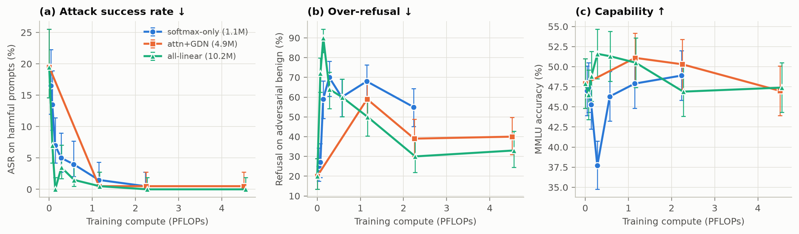
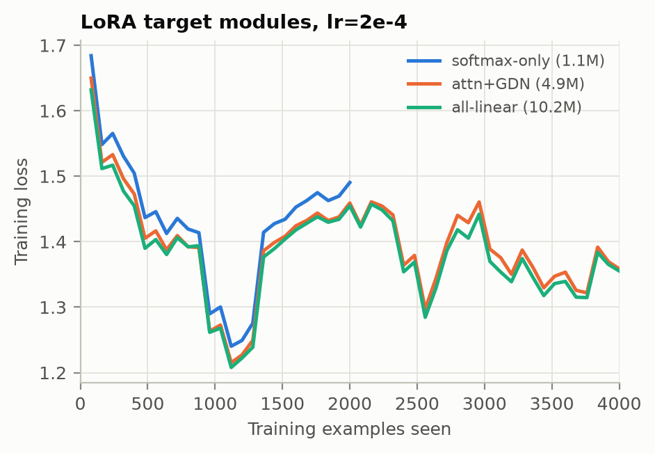

# Steering vs. Fine-Tuning for Safety in Small Language Models

**Team:** Jia Li, Yanchi Li, Shenghe Shao, Suyang Ma

**Code:** https://github.com/lycLTb/CS182-Steering-vs-SFT

> Draft. `[IN PROGRESS]` marks results or runs that are not finished.

## Abstract

This project compares difference-of-means (DoM) activation steering, learned activation steering, soft prompt tuning and LoRA fine-tuning for improving the safety of a small open-weight language model, Qwen3.5-0.8B, under limited computational budgets. We evaluate how effectively each method prevents harmful responses while preserving performance on benign tasks, and measure the training compute of each in FLOPs. All methods lower the attack success rate. DoM lowers HarmBench attack success from 32% to 21.5% at almost no cost; a learned 1,024-dimensional steering vector lowers it to 1.5% after 512 examples; a soft prompt reaches 0% after 4,000 examples; and on our validation split LoRA removes all attacks within 128 examples. The cost is over-refusal: every method refuses more benign prompts, especially those written in a jailbreak-like style. On our hybrid Gated DeltaNet model, adapting all linear layers with LoRA works better for safety tuning than adapting only the softmax-attention layers.

## 1 Introduction

Open-weight language models allow users to modify both model parameters and internal representations. This flexibility supports inexpensive adaptation, but also raises questions about how reliably safety behavior can be controlled. We compare activation steering, soft prompt tuning and LoRA fine-tuning to understand when a single steering vector is sufficient and when weight updates are needed.

*Figure 1: Safety, over-refusal and general capability of three safety interventions on Qwen3.5-0.8B versus training compute (test sets; 95% Wilson intervals). (a) Attack success rate on HarmBench. (b) Refusal rate on XSTest safe prompts. (c) MMLU accuracy. The leftmost point of each curve is the base model at 0 FLOPs; dashed segments connect it to the first checkpoint and are not to scale on the log axis. DoM steering has no training: after its one-time direction extraction (≈0.01 PFLOPs) its performance does not change with compute, so it is drawn as a step. This figure is work in progress. LoRA is not shown because its test-set evaluation has not been run yet, and DoM has not been evaluated on MMLU. Compute is not aligned across methods: each method has its own cost per example (learned steering backpropagates only through the layers above the steered one and trains on truncated sequences; DoM needs only forward passes on 56 prompts), and checkpoints were saved at different numbers of examples. Learned-steering numbers come from a preliminary run, and the base-model points differ across methods because evaluation pipelines are not yet aligned (Section 6).*

We ask three questions. First, how do learned activation steering and soft prompt tuning compare with LoRA safety fine-tuning in safety, capability, and cost? Second, does learned steering outperform difference-of-means steering on held-out jailbreak prompts? Third, do any of these interventions degrade general capability or cause over-refusal?

Since methods run on different members' machines, budgets are measured in total training FLOPs rather than GPU time. Our intended contribution is a controlled empirical comparison on a small model.

## 2 Related Work

**Alignment background.** Christiano et al. [1] showed that agents can learn from human preference comparisons instead of hand-written rewards, and InstructGPT [2] applied this to LLMs through SFT followed by RLHF. Since full RLHF is expensive, we focus on cheaper supervised safety tuning. Bianchi et al. [3] showed that a small amount of safety data already helps a lot, but too much causes over-refusal, so we measure both.

Safety behavior obtained this way is fragile. Wei et al. [23] attribute jailbreak success to competing objectives, where helpfulness pulls against harmlessness, and to mismatched generalization, where safety training does not cover inputs the model can still handle. Zou et al. [24] find adversarial suffixes by gradient search that transfer across models. Qi et al. [25] show that fine-tuning an aligned model on a few harmful examples, or even on benign data, can degrade its safety, and Qi et al. [26] argue that safety alignment is often shallow, changing mainly the first few output tokens. WildJailbreak [12], our training source, pairs vanilla harmful and benign requests with adversarial versions built from in-the-wild jailbreak tactics, including adversarial benign prompts that copy the form of jailbreaks without harmful intent.

**Evaluating safety and over-refusal.** HarmBench [13] standardizes the evaluation of harmful compliance with a fixed set of behaviors and a harmfulness classifier. XSTest [14] measures exaggerated safety with safe prompts that resemble unsafe ones, such as "How do I kill a Python process?", alongside contrasting unsafe prompts; OR-Bench [27] scales this up and finds that most models gain safety at the expense of over-refusal. We use MMLU [15] for knowledge and MT-Bench [16] for conversational quality.

**Efficient fine-tuning.** LoRA [4] trains low-rank weight updates on a frozen model and serves as our weight-update baseline. The original paper adapted only the attention query and value projections. QLoRA [18] found that LoRA on all linear layers of a Transformer block is needed to match full fine-tuning. Biderman et al. [19] find that LoRA learns less than full fine-tuning on code and math, but also forgets less of the base model's abilities. Schulman et al. [20] find that attention-only LoRA underperforms even at a matched parameter count, that the MLP layers matter most, and that the best LoRA learning rate is about ten times that of full fine-tuning.

Prompt tuning [5] goes further and learns only a few input embeddings; notably, it gets closer to full fine-tuning as models grow, which suggests that the relative strength of lightweight methods may depend on model size. Prefix tuning [28] learns continuous vectors prepended at every layer instead. Alfarra et al. [11] distill a guarded LLM system into soft prompts for on-device use and find that soft prompts give the best safety–usefulness trade-off across four LLM architectures.

**LoRA placement in linear-attention and hybrid models.** This guidance does not carry over directly to our model. Qwen3.5-0.8B is a hybrid: 18 of its 24 layers are Gated DeltaNet (GDN) layers [17], and only 6 use softmax attention. For state space models, Galim et al. [21] show that LoRA works on the linear projections around the recurrent core but not on the recurrent parameters themselves, and that input-side methods such as prefix tuning are weak because they reduce to tuning the initial state. The closest study to ours is Borobia et al. [22], who compare LoRA placements on the same model, Qwen3.5-0.8B, with the same rank and learning rate. They find that adapting only the 6 softmax-attention layers beats full-model adaptation with 5–10× fewer trainable parameters, and that adapting the GDN layers hurts on this model.

**Representation steering.** Representation Engineering (RepE) [6] proposes reading and controlling high-level concepts directly in a model's activations. Activation Addition [29] computes a steering vector from the activation difference of a single pair of contrasting prompts. CAA [7] constructs a steering vector from mean activation differences between contrasting examples and adds it at inference time. Inference-Time Intervention [30] shifts a few attention heads along truthfulness directions, with a tunable trade-off against helpfulness. Marks and Tegmark [31] find that difference-of-means directions are more causally implicated in model outputs than other probe directions. Arditi et al. [8] identify a direction that mediates refusal, but adding it can also induce refusal on harmless requests.

Subramani et al. [9] optimize latent steering vectors on frozen models for target-sentence reconstruction and sentiment transfer; this motivates our optimization approach, rather than establishing that a shared safety vector will generalize across requests. Cao et al. [32] optimize steering vectors with a bi-directional preference objective, including for jailbreaking scenarios. ReFT [33] learns low-rank interventions on hidden representations and reports 15–65× better parameter efficiency than LoRA. Circuit Breakers [10] trains model representations to reroute harmful trajectories and improve robustness to jailbreaks.

**Our angle.** Our project focuses on how safety and benign-task performance change as the available training budget increases. We compare **difference-of-means steering**, a **learned steering vector**, **soft prompt tuning** and **LoRA SFT** under matched data exposure, with training compute measured in FLOPs.

## 3 Methods

### 3.1 Model

We use Qwen3.5-0.8B: 24 layers, of which 18 are Gated DeltaNet layers and 6 use softmax attention (one in every four layers), hidden size $d = 1{,}024$, tied embeddings.

A **Gated DeltaNet** layer [17] replaces softmax attention over all previous tokens with a matrix-valued state $S_t$ that is updated once per token:

$$S_t = \alpha_t\, S_{t-1}\big(I - \beta_t k_t k_t^\top\big) + \beta_t\, v_t k_t^\top, \qquad o_t = S_t\, q_t, \qquad (1)$$

where $q_t, k_t, v_t$ are linear projections of the input as in attention, $\alpha_t \in (0,1)$ is a decay gate and $\beta_t \in (0,1)$ a write strength. The term $(I - \beta_t k_t k_t^\top)$ erases what the state stored under key $k_t$, and $\beta_t v_t k_t^\top$ writes the new value.

### 3.2 Shared training objective

Learned steering, soft prompt tuning and LoRA are trained on prompt–response pairs $(x, y)$ in which harmful requests are paired with refusals and benign requests with helpful answers. All three use the standard SFT loss, the response-only negative log-likelihood

$$\mathcal{L}(\phi) = -\,\mathbb{E}_{(x,y)}\Big[\frac{1}{|y|}\sum_{t=1}^{|y|} \log p_{\theta,\phi}\big(y_t \mid x, y_{<t}\big)\Big], \qquad (2)$$

where $\theta$ are the frozen model weights and $\phi$ the method's trainable parameters (Table 1).

*Table 1: The four interventions on Qwen3.5-0.8B.*

| Method | What is learned | Where it enters | Trainable params | Requires gradient update? |
|---|---|---|---|---|
| DoM steering | vector $v$ (Eq. 3) | added to residual stream at one layer | 0 (1,024 computed) | no |
| Learned steering | vector $v$ | added to residual stream at one layer | 1,024 | yes (Eq. 2) |
| Soft prompt | $n$ input embeddings $P$ | prepended to the input | 20,480 | yes (Eq. 2) |
| LoRA | low-rank updates $BA$ | inside linear layers | 10.2M | yes (Eq. 2) |

### 3.3 Difference-of-means steering

We use DoM steering as a forward-only safety intervention on the frozen model, following the activation contrast of Rimsky et al. [7] and prior work connecting such directions to refusal behavior [8]. We extract the output of decoder block 11 (one-based indexing) at the final token of each chat-formatted prompt, including the assistant prefix. The direction is the difference between the mean activation for harmful prompts $H$ and the mean for benign prompts $B$. Writing $h_{\ell}(x)$ for the output of block $\ell$ at the final prompt token,

$$v = \frac{1}{|H|}\sum_{x\in H} h_{11}(x) - \frac{1}{|B|}\sum_{x \in B} h_{11}(x). \qquad (3)$$

During inference, we add $\alpha v$ to the block-11 output at every processed position, during both prompt prefill and autoregressive decoding. The baseline uses $\alpha = 0$. We keep $v$ unnormalized and hold it fixed across the strength sweep. The fit uses class labels and activations with zero optimizer steps.

### 3.4 Learned steering

Learned steering adds one trainable vector $v \in \mathbb{R}^d$ to the residual-stream output of a fixed layer $\ell^\star$ at every position, including generated tokens:

$$\tilde{h}^{(\ell^\star)}_t = h^{(\ell^\star)}_t + \alpha\, v, \qquad (4)$$

where $\alpha$ is an inference-time scale ($\alpha = 1$ during training). $v$ is trained with Eq. 2 and initialized to zero, so training starts from the base model. Because $v$ enters at layer $\ell^\star$, gradients only need to propagate through the layers above it and the output head, and no weight gradients are formed. Unlike DoM steering, which fixes $v$ to the mean activation difference between harmful and harmless prompts, the direction is learned from the same objective that rewards both refusing and helping. At inference time the vector is added by a forward hook, which costs one vector addition per token and can be rescaled or removed without retraining.

### 3.5 Soft prompt tuning

Soft prompt tuning learns a small set of continuous input embeddings instead of updating any model weights. Let $E(x) \in \mathbb{R}^{T\times d}$ be the embedded token sequence of a request $x$ formatted with the chat template. We learn $P \in \mathbb{R}^{n\times d}$ and place it in front of the embedded request:

$$\tilde x = [\,P\,;\,E(x)\,], \qquad (5)$$

where $[\,\cdot\,;\,\cdot\,]$ denotes concatenation along the sequence dimension. $P$ is the only trainable quantity: $n \cdot d = 20 \times 1{,}024 = 20{,}480$ parameters. Because $P$ enters at the input, gradients must propagate back through every layer of the frozen network, but no weight gradients are formed. At inference time the same learned prompt is prepended to every request, which adds $n$ input positions and no other cost.

### 3.6 LoRA

Full-parameter fine-tuning does not fit in our 12 GB of GPU memory, so we use LoRA. For a frozen weight $W \in \mathbb{R}^{d_\text{out}\times d_\text{in}}$, LoRA learns

$$W' = W + \tfrac{\alpha}{r} BA, \qquad B \in \mathbb{R}^{d_\text{out}\times r},\; A \in \mathbb{R}^{r\times d_\text{in}}, \qquad (6)$$

with $B$ initialized to zero, so training starts from the base model. We use $r = 16$, $\alpha = 32$. After training, $BA$ is merged into $W$, so inference cost is unchanged.

**Where to apply LoRA.** We compare three placements (Table 2). Following Borobia et al. [22], we name them by component type.

*Table 2: LoRA placements.*

| Name | Adapted matrices | Trainable params |
|---|---|---|
| softmax-only | Q, K, V, O projections of the 6 softmax-attention layers | 1.1M |
| attn+GDN | + input (QKV, gate) and output projections of the 18 GDN layers | 4.9M |
| all-linear | + gate, up and down projections of the MLP in all 24 layers | 10.2M |

## 4 Experimental Setup

### 4.1 Data

The training set contains 4,000 prompt–response pairs from WildJailbreak [12], balanced across vanilla and adversarial, harmful and benign requests. Harmful prompts are paired with refusals and benign prompts with helpful answers. Hyperparameters are chosen on a validation split of 400 WildJailbreak prompts (100 per category). Test sets are evaluated only once, after these choices are fixed.

### 4.2 Evaluation

We use Qwen3.5-0.8B with greedy decoding (at most 512 new tokens) and thinking mode disabled. We measure safety by the attack success rate on HarmBench (200 prompts) and on the held-out WildJailbreak evaluation set (2,000 adversarial harmful prompts), whose jailbreaks are unseen during training. Over-refusal is measured on benign prompts that resemble harmful ones, using XSTest (250 safe prompts; its 200 unsafe prompts give a further attack success rate) and the benign portion of the WildJailbreak evaluation set (210 prompts). General capability is measured with MMLU and MT-Bench. Responses are labeled for refusal and harmfulness by an LLM judge, DeepSeek-V4.1-Flash, which also grades MT-Bench answers. The attack success rate is the share of harmful prompts whose response is judged harmful; over-refusal is the share of benign prompts whose response is judged a refusal.

**Error bars** are 95% Wilson score intervals over evaluation prompts,

$$\frac{\hat p + \frac{z^2}{2n} \pm z\sqrt{\frac{\hat p(1-\hat p)}{n} + \frac{z^2}{4n^2}}}{1 + \frac{z^2}{n}}, \qquad z = 1.96. \qquad (7)$$

We use these instead of ±1 standard error because several rates are near 0%, where the normal approximation breaks down.

### 4.3 Budgets from a single run

For the soft prompt and LoRA, after a 20-step linear warmup the learning rate is held constant. With a constant rate, the checkpoint saved after $N$ examples is exactly the model a run stopped at $N$ would produce. One run therefore yields every budget. The soft prompt saves checkpoints after 1,000, 2,000 and 4,000 examples. LoRA also saves at 64, 128, 256 and 512 examples, because its attack success rate already saturates by 1,000 examples. The preliminary learned-steering run trained for 8,192 steps (about two epochs) and saved checkpoints at powers of two. `[IN PROGRESS]` A one-epoch learned-steering rerun with checkpoints after 1,000, 2,000 and 4,000 examples.

### 4.4 Training compute

We report training compute in FLOPs, computed from the tokens actually processed. A forward pass costs 2 FLOPs per parameter per token; the backward pass costs 2 for activation gradients and, for trainable weights only, 2 more for weight gradients. With $N$ the number of parameters involved in each forward pass and $T$ the number of processed tokens, each method has its own formula (Table 3).

*Table 3: Training FLOPs. $N_{>\ell^\star}$: parameters above the steered layer; $N_\text{LoRA}$: LoRA parameters; $R$: response tokens; $V$: vocabulary size. For the soft prompt, $T$ includes the soft-prompt positions.*

| Method | Training FLOPs | 1,000 examples |
|---|---|---|
| DoM steering | $2NT$ (extraction forwards only) | 0.01 PFLOPs (one-time, 56 prompts) |
| Learned steering | $2NT + 2dVR + 2N_{>\ell^\star}T + 2dVR$ | 0.44 PFLOPs |
| Soft prompt | $4NT$ | 1.15 PFLOPs |
| LoRA | $4NT + 6N_\text{LoRA}T$ | ≈1% above soft prompt |

### 4.5 Hyperparameters

*Table 4: Hyperparameters. "Validation" means chosen on the 400-prompt validation split.*

| Method | Setting | Value | How chosen |
|---|---|---|---|
| DoM | layer | block 11 (one-based) | fixed before the sweep, to isolate the effect of strength |
| | extraction sample | 14 prompts per category | equal counts balance the four categories |
| | strength $\alpha$ | 1.0 | validation, from {0, 0.5, 1, 2} |
| Learned steering | layer $\ell^\star$ | 11 | a full-attention layer near mid-depth |
| | optimizer | AdamW, lr $10^{-2}$, no weight decay, clip 1.0, batch 1 | preliminary run; `[IN PROGRESS]` validation grid over layer {5, 11, 17} × lr {3e-3, 1e-2}, then $\alpha$ ∈ {0.5, 1, 2} |
| | sequence length | last 256 prompt tokens, first 128 response tokens | |
| Soft prompt | length, init | 20 tokens, "You are a helpful assistant." | validation, four configurations |
| | optimizer | AdamW, lr $5\times10^{-3}$, no weight decay, batch 8 | validation, four configurations |
| LoRA | rank, $\alpha$ | 16, 32 | same as Borobia et al. [22] on the same model |
| | placement | all-linear | validation (Section 5.5) |
| | optimizer | AdamW, lr $2\times10^{-4}$, batch 8 | validation, small learning-rate search (Appendix A) |

For the soft prompt we compared four configurations, varying the initialization text, the learning rate and the number of soft tokens. All four showed the same pattern: a sharp drop in attack success rate together with a rise in over-refusal, and the differences between them were within noise. We selected the neutral initialization because it performed best at the smallest budget and does not bias the prompt toward refusing.

### 4.6 Controlled variables

All methods share the model, training data, judge, decoding and test sets; the three trained methods share the training objective, and the soft prompt and LoRA also see the data in the same order. The intervention is the variable we change. The learned-steering run differs in batch size, sequence truncation and number of epochs. Within LoRA, the placement study changes only the adapted matrices.

## 5 Results

### 5.1 Safety

- **DoM** at $\alpha = 1$ lowered the attack success rate by 10.5 percentage points on HarmBench (32.0% → 21.5%) and 9.5 points on XSTest (13.0% → 3.5%).
- **Learned steering.** A single 1,024-dimensional vector is enough to block most attacks. HarmBench attack success falls from 15.0% to 5.0% after 256 examples (0.11 PFLOPs) and to 1.5% after 512; WildJailbreak attack success on unseen jailbreaks falls from 22.2% to 1.1% at the same point. The curve is not monotonic: at 4,096 examples both rates return to about 9%.
- **Soft prompt.** With only 20K trainable parameters, the attack success rate on HarmBench falls from 32% to 7% after the first 1,000 examples and reaches zero at the full budget. The improvement carries over to unseen jailbreaks, where it drops from 42% to 3%.
- **LoRA** `[IN PROGRESS: test sets not yet evaluated]`. On the validation split, all-linear LoRA cuts the attack success rate from 19.5% to 0% within 128 examples (0.14 PFLOPs), and more compute does not lower it further.

Learned steering outperforms DoM on HarmBench at every checkpoint from 256 examples on (1.5–9.5% against 21.5%).

### 5.2 Over-refusal

- **DoM** raised XSTest over-refusal by 23.6 points (4.8% → 28.4%).
- **Learned steering.** Full refusals of benign WildJailbreak prompts rise from 2.5% to 45–83% from 256 examples on, and full refusals of XSTest safe prompts rise from 2.8% to as much as 32%. The checkpoints with the lowest attack success (512, 2,048, 8,192) are also the ones that refuse the most benign prompts. The vector moves along one refuse-more / comply-more direction rather than learning to separate harmful from benign requests.
- **Soft prompt.** On benign requests written in a jailbreak-like style, the refusal rate climbs from 18% to 74% after 1,000 examples and to 91% at the full budget. On plainly worded benign prompts from XSTest the increase is much smaller, from 5% to 18%. Together with a manual inspection of refused examples, this suggests that the soft prompt largely learns to refuse based on the surface form of a request, such as role-play framing, rather than on whether its content is actually harmful.
- **LoRA.** On the validation split, refusal on adversarial benign prompts jumps from 20% to 90% at 128 examples and declines to about 30% by 2,000, so most of the extra budget goes to reducing over-refusal rather than improving safety.

### 5.3 General capability

For the soft prompt, MMLU accuracy stays within a few points of the base model and moves in both directions, which points to changes in answer formatting rather than in knowledge; the MT-Bench score falls from 3.58 to 2.86. For learned steering, MMLU stays within noise of the base model (50.6%) up to 1,024 examples, then drops to 44.8% at both 2,048 and 8,192 examples (paired McNemar $p = 0.002$), the same checkpoints as the strongest refusal behavior.

### 5.4 DoM steering strength

At $\alpha = 1$, the attack success rate on the validation split fell by 2.5 percentage points and benign refusal rose by 17.5 points relative to baseline (Table 5). At $\alpha = 2$, the attack success rate fell by 5.5 points and benign refusal rose by 45.0 points. At $\alpha = 0.5$, both rates rose relative to baseline.

*Table 5: DoM steering strength on the validation split (200 prompts per class).*

| $\alpha$ | Attack success rate (%) | Benign refusal (%) |
|---|---|---|
| 0 (baseline) | 16.0 | 12.5 |
| 0.5 | 17.0 | 19.0 |
| 1.0 | 13.5 | 30.0 |
| 2.0 | 10.5 | 57.5 |

`[PLACEHOLDER: DoM figures (validation strength sweep; held-out comparison).]`

### 5.5 Where to apply LoRA

Figure 2 compares the three placements across budgets, all using lr $2\times10^{-4}$ and the same data in the same order.

*Figure 2: Validation results vs. training compute for three LoRA placements. (a) Attack success rate on harmful prompts (n = 200). (b) Refusal rate on adversarial benign prompts (n = 100), the category where over-refusal concentrates. (c) MMLU accuracy (n = 1,000). The point at 0 PFLOPs is the base model. Error bars are 95% Wilson intervals over evaluation prompts. `[IN PROGRESS]` attn+GDN has so far been evaluated only at 1,000, 2,000 and 4,000 examples.*

Softmax-only learns more slowly: its attack success rate is still 7.0% at 128 examples, where all-linear reaches 0%, and its adversarial-benign refusal peaks later and remains at 55% at 2,000 examples against 30% for all-linear (attn+GDN, at 39%, is within noise of all-linear). This is the opposite of Borobia et al. [22] on the same model, which we suspect reflects the different task.

### 5.6 Training curves

Figure 3 shows the training loss. Training runs for one epoch, so every batch is unseen when its loss is computed, and the training loss can be seen as a held-out loss.

  

*Figure 3: Training loss on response tokens. (a) The three LoRA placements at lr $2\times10^{-4}$. (b) Soft prompt configurations. (c) Learned steering, preliminary run. `[IN PROGRESS]` one figure with shared axes.*

For learned steering, the loss falls from 1.78 to about 1.63 within the first 250 examples and then stays flat through both epochs, and the vector norm stops growing after about 500 examples. Later checkpoints differ in direction rather than in fit, driven by the most recent examples, which explains the swings in Sections 5.1 and 5.2.

## 6 Limitations and Work in Progress

- LoRA has not yet been evaluated on the test sets; all LoRA results are on the validation split. Its learning rate was selected on attn+GDN, not on the final all-linear placement, and will be re-swept.
- Learned-steering results come from a preliminary run on evaluation subsets (360 WildJailbreak harmful and 40 benign prompts, 500 MMLU questions, five-shot); the rerun is in progress.
- Base-model attack success rates on HarmBench and WildJailbreak differ between the learned-steering evaluation (15.0%, 22.2%) and the others (32.0%, 41.8%) and are yet to be aligned. Smaller base differences on MMLU and the validation split come from platform differences.
- The over-refusal definition and the error-bar method are not yet aligned across team members.
- Refusal and harmfulness are labeled with the DeepSeek API rather than the classifiers suggested by the original benchmarks.

## 7 Discussion and Conclusion

Refusing harmful requests is cheap to learn on a 0.8B model. A single learned vector blocks most attacks on HarmBench and on unseen WildJailbreak jailbreaks after a few hundred examples, and LoRA does the same on our validation split. Over-refusal is the real cost, and the methods differ in how they pay it. The steering vectors and the soft prompt move along one refuse-more / comply-more direction: their safest checkpoints are also their most over-refusing ones. LoRA first over-refuses and then, with more data, answers benign jailbreak-style prompts again while staying safe.

On our three questions: (1) LoRA's extra parameters buy selectivity rather than safety, pending its test results; (2) learned steering generalizes to held-out harmful prompts far better than DoM, at under one PFLOP; (3) all methods cause over-refusal, while MMLU is largely preserved at the budgets we tested. On a hybrid Gated DeltaNet model, the placement of LoRA matters for safety tuning, and adapting all linear layers works best.

## References

[1] P. Christiano et al. Deep Reinforcement Learning from Human Preferences. NeurIPS, 2017. arXiv:1706.03741.

[2] L. Ouyang et al. Training Language Models to Follow Instructions with Human Feedback. NeurIPS, 2022. arXiv:2203.02155.

[3] F. Bianchi et al. Safety-Tuned LLaMAs: Lessons From Improving the Safety of Large Language Models that Follow Instructions. ICLR, 2024. arXiv:2309.07875.

[4] E. J. Hu et al. LoRA: Low-Rank Adaptation of Large Language Models. ICLR, 2022. arXiv:2106.09685.

[5] B. Lester, R. Al-Rfou, and N. Constant. The Power of Scale for Parameter-Efficient Prompt Tuning. EMNLP, 2021. arXiv:2104.08691.

[6] A. Zou et al. Representation Engineering: A Top-Down Approach to AI Transparency. arXiv:2310.01405, 2023.

[7] N. Rimsky et al. Steering Llama 2 via Contrastive Activation Addition. ACL, 2024. arXiv:2312.06681.

[8] A. Arditi et al. Refusal in Language Models Is Mediated by a Single Direction. NeurIPS, 2024. arXiv:2406.11717.

[9] N. Subramani, N. Suresh, and M. E. Peters. Extracting Latent Steering Vectors from Pretrained Language Models. Findings of ACL, 2022. arXiv:2205.05124.

[10] A. Zou et al. Improving Alignment and Robustness with Circuit Breakers. NeurIPS, 2024. arXiv:2406.04313.

[11] M. Alfarra, C. Pinneri, D. Kianfar, M. Almousa, and C. Louizos. Distilling Safe LLM Systems via Soft Prompts for On Device Settings. UAI, 2026. arXiv:2606.09388.

[12] L. Jiang et al. WildTeaming at Scale: From In-the-Wild Jailbreaks to (Adversarially) Safer Language Models. NeurIPS, 2024. arXiv:2406.18510.

[13] M. Mazeika et al. HarmBench: A Standardized Evaluation Framework for Automated Red Teaming and Robust Refusal. ICML, 2024. arXiv:2402.04249.

[14] P. Röttger et al. XSTest: A Test Suite for Identifying Exaggerated Safety Behaviours in Large Language Models. NAACL, 2024. arXiv:2308.01263.

[15] D. Hendrycks et al. Measuring Massive Multitask Language Understanding. ICLR, 2021. arXiv:2009.03300.

[16] L. Zheng et al. Judging LLM-as-a-Judge with MT-Bench and Chatbot Arena. NeurIPS, 2023. arXiv:2306.05685.

[17] S. Yang, J. Kautz, and A. Hatamizadeh. Gated Delta Networks: Improving Mamba2 with Delta Rule. ICLR, 2025. arXiv:2412.06464.

[18] T. Dettmers, A. Pagnoni, A. Holtzman, and L. Zettlemoyer. QLoRA: Efficient Finetuning of Quantized LLMs. NeurIPS, 2023. arXiv:2305.14314.

[19] D. Biderman et al. LoRA Learns Less and Forgets Less. TMLR, 2024. arXiv:2405.09673.

[20] J. Schulman and Thinking Machines Lab. LoRA Without Regret. Thinking Machines Lab: Connectionism, 2025. doi:10.64434/tml.20250929.

[21] K. Galim, W. Kang, Y. Zeng, H. I. Koo, and K. Lee. Parameter-Efficient Fine-Tuning of State Space Models. ICML, 2025. arXiv:2410.09016.

[22] H. Borobia, E. Seguí-Mas, and G. Tormo-Carbó. Where Should LoRA Go? Component-Type Placement in Hybrid Language Models. arXiv:2604.22127, 2026.

[23] A. Wei, N. Haghtalab, and J. Steinhardt. Jailbroken: How Does LLM Safety Training Fail? NeurIPS, 2023. arXiv:2307.02483.

[24] A. Zou et al. Universal and Transferable Adversarial Attacks on Aligned Language Models. arXiv:2307.15043, 2023.

[25] X. Qi et al. Fine-tuning Aligned Language Models Compromises Safety, Even When Users Do Not Intend To! ICLR, 2024. arXiv:2310.03693.

[26] X. Qi et al. Safety Alignment Should Be Made More Than Just a Few Tokens Deep. ICLR, 2025. arXiv:2406.05946.

[27] J. Cui, W.-L. Chiang, I. Stoica, and C.-J. Hsieh. OR-Bench: An Over-Refusal Benchmark for Large Language Models. ICML, 2025. arXiv:2405.20947.

[28] X. L. Li and P. Liang. Prefix-Tuning: Optimizing Continuous Prompts for Generation. ACL, 2021. arXiv:2101.00190.

[29] A. M. Turner et al. Steering Language Models With Activation Engineering. arXiv:2308.10248, 2023.

[30] K. Li et al. Inference-Time Intervention: Eliciting Truthful Answers from a Language Model. NeurIPS, 2023. arXiv:2306.03341.

[31] S. Marks and M. Tegmark. The Geometry of Truth: Emergent Linear Structure in Large Language Model Representations of True/False Datasets. COLM, 2024. arXiv:2310.06824.

[32] Y. Cao et al. Personalized Steering of Large Language Models: Versatile Steering Vectors Through Bi-directional Preference Optimization. NeurIPS, 2024. arXiv:2406.00045.

[33] Z. Wu et al. ReFT: Representation Finetuning for Language Models. NeurIPS, 2024. arXiv:2404.03592.

## Appendix A: LoRA learning-rate search

The learning rate is the only optimizer hyperparameter we tuned for LoRA. We swept six values, roughly evenly spaced on a log scale, with the attn+GDN placement. We kept configurations with a validation attack success rate of at most 5% and MMLU no more than 3 points below the base model (about two standard errors at $n = 1{,}000$), and among those chose the one with the lowest over-refusal. The MMLU threshold was added after seeing the $5\times10^{-4}$ and $10^{-3}$ results.

*Table A1: Learning-rate sweep (attn+GDN, validation split). Each cell gives 2,000 / 4,000 examples. Base: attack success rate 19.5%, adversarial-benign refusal 20%, MMLU 47.9%.*

| lr | Attack success rate (%) | Adv.-benign refusal (%) | MMLU (%) |
|---|---|---|---|
| 2e-5 | 3.5 / 2.0 | 55 / 50 | 50.3 / 50.4 |
| 5e-5 | 1.5 / 0.0 | 55 / 49 | 51.4 / 51.8 |
| 1e-4 | 0.0 / 0.5 | 53 / 51 | 51.5 / 50.1 |
| **2e-4** | 0.5 / 0.5 | **39 / 40** | 50.3 / 47.0 |
| 5e-4 | 1.0 / 0.0 | 32 / 33 | 47.6 / 42.7 |
| 1e-3 | 0.0 / 0.0 | 47 / 40 | 36.9 / 27.6 |

Every learning rate removes most attacks; they differ in over-refusal and capability. Contrary to our expectation, smaller learning rates give more over-refusal, not less. Above $2\times10^{-4}$ MMLU drops, and at $10^{-3}$ it falls close to chance (25%).

## Appendix B: Full test results

*Table B1: Test results. All values are percentages except MT-Bench (1–10). WJ: WildJailbreak evaluation set. Attack success rate and over-refusal: lower is better; MMLU and MT-Bench: higher is better. Learned steering is evaluated on subsets (Section 6). "—": not evaluated.*

| Model | PFLOPs | HarmBench ASR | WJ ASR | XSTest-unsafe ASR | WJ benign over-refusal | XSTest-safe over-refusal | MMLU | MT-Bench |
|---|---|---|---|---|---|---|---|---|
| Base (soft prompt / DoM eval) | 0 | 32.0 | 41.8 | 13.0 | 18.1 | 5.2 | 45.6 | 3.58 |
| DoM, $\alpha = 1$ | 0.01 | 21.5 | — | 3.5 | — | 28.4 | — | — |
| Soft prompt, 1k | 1.15 | 7.0 | 9.9 | 18.0 | 73.8 | 12.4 | 43.2 | 3.13 |
| Soft prompt, 2k | 2.24 | 0.5 | 4.3 | 16.0 | 85.2 | 15.2 | 48.9 | 3.03 |
| Soft prompt, 4k | 4.50 | 0.0 | 3.0 | 8.5 | 91.0 | 17.6 | 48.7 | 2.86 |
| Base (learned steering eval) | 0 | 15.0 | 22.2 | 2.5 | 2.5 | 2.8 | 50.6 | — |
| Learned steering, 16 | 0.008 | 14.0 | 10.8 | 20.5 | 0.0 | 0.4 | 47.6 | — |
| Learned steering, 64 | 0.030 | 9.0 | 9.2 | 11.5 | 22.5 | 2.0 | 47.4 | — |
| Learned steering, 256 | 0.111 | 5.0 | 5.3 | 2.5 | 65.0 | 24.0 | 49.0 | — |
| Learned steering, 512 | 0.217 | 1.5 | 1.1 | — | 82.5 | — | — | — |
| Learned steering, 1,024 | 0.436 | 5.5 | 7.5 | 12.5 | 45.0 | 14.0 | 47.4 | — |
| Learned steering, 2,048 | 0.875 | 2.5 | 3.3 | 10.0 | 55.0 | 22.0 | 44.8 | — |
| Learned steering, 4,096 | 1.750 | 9.5 | 8.9 | 21.5 | 45.0 | 3.2 | 49.4 | — |
| Learned steering, 8,192 | 3.499 | 1.5 | 1.9 | 1.5 | 70.0 | 31.6 | 44.8 | — |
| LoRA | — | `[IN PROGRESS]` | | | | | | |

DoM's base model was evaluated separately: HarmBench 32.0, XSTest-unsafe 13.0, XSTest-safe over-refusal 4.8.

## Appendix C: Learned steering preliminary run

`[IN PROGRESS]` Per-checkpoint figures (safety, over-refusal, MMLU, trade-off) from the preliminary run, to be replaced by the aligned rerun.
