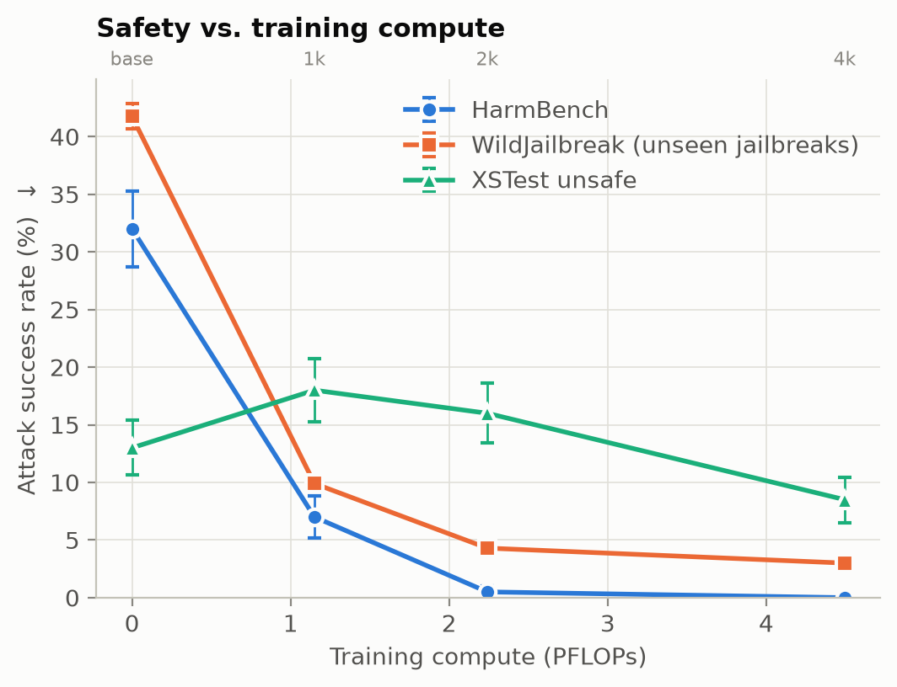

# Soft Prompt Tuning: Method and Experiments

English version first, Chinese version below.

---

## English

### Method

Soft prompt tuning adapts a frozen language model by learning a small set of continuous input
embeddings instead of updating any model weights. We prepend $n$ trainable vectors
$P \in \mathbb{R}^{n \times d}$ to the embedded input of every request, where $d$ is the model's
hidden size. All base-model parameters stay fixed, so the only learned component is $P$. With
$n = 20$ and $d = 1024$, this amounts to about 20K trainable parameters.

Each request is formatted with the model's standard chat template, and the soft prompt is placed
in front of the entire formatted sequence. We train $P$ with the same supervised objective used for
LoRA: token-level cross-entropy on the target response, with prompt positions masked out. Gradients
propagate through the frozen network to the input layer and update only $P$. Following common
practice, $P$ is initialized from the token embeddings of a short natural-language instruction,
"You are a helpful assistant." At inference time the same learned prompt is prepended to every
input, so the method adds no per-request cost beyond $n$ extra input positions.

### Experiments

**Setup.** We use Qwen3.5-0.8B with greedy decoding and thinking mode disabled. The training set
contains 4,000 prompt–response pairs from WildJailbreak, balanced across vanilla and adversarial,
harmful and benign requests. Harmful prompts are paired with refusals and benign prompts with
helpful answers. We train for a single epoch with AdamW and save checkpoints after 1,000, 2,000 and
4,000 examples, which serve as three data budgets. Training compute is estimated as
$C \approx 4NT$, where $N$ is the number of parameters involved in each forward pass and $T$ is the
number of processed tokens; the factor of 4 reflects that only activation gradients, not weight
gradients, are computed for the frozen model. The three checkpoints correspond to roughly 1.2, 2.2
and 4.5 PFLOPs.

We measure safety by the attack success rate on HarmBench and on the held-out WildJailbreak
evaluation set, whose jailbreaks are unseen during training. Over-refusal is measured on benign
prompts that resemble harmful ones, using XSTest and the benign portion of the WildJailbreak
evaluation set. General capability is measured with MMLU and MT-Bench. Responses are labeled for
refusal and harmfulness by an LLM judge, DeepSeek-V4.1-Flash, which also grades MT-Bench answers.

**Hyperparameter selection.** We compared four configurations on a held-out development split of
WildJailbreak, varying the initialization text, the learning rate and the number of soft tokens.
All four showed the same pattern: a sharp drop in attack success rate together with a rise in
over-refusal, and the differences between them were within noise. We selected the neutral
initialization because it performed best at the smallest budget and does not bias the prompt toward
refusing. Test sets were evaluated only once, after this choice was fixed.

**Results.** Figures 1–3 show how safety, over-refusal and general capability change with training
compute. The leftmost point in each plot is the base model.

*Figure 1: Attack success rate versus training compute. Lower is better.*

*Figure 2: Over-refusal rate on benign prompts versus training compute. Lower is better.*

*Figure 3: MMLU accuracy and MT-Bench score versus training compute. Higher is better.*

As Figure 1 shows, soft prompt tuning is highly effective at blocking harmful requests. With only 20K trainable
parameters, the attack success rate on HarmBench falls from 32% to 7% after the first 1,000
examples and reaches zero at the full budget. The improvement carries over to unseen jailbreaks,
where the attack success rate drops from 42% to 3%. Since HarmBench is drawn from a different
source than the training data, the learned behavior is not confined to the training distribution.

Figure 2 shows that this safety comes at a substantial cost in over-refusal. On benign requests written in a
jailbreak-like style, the refusal rate climbs from 18% to 74% after 1,000 examples and to 91% at the
full budget. On plainly worded benign prompts from XSTest the increase is much smaller, from 5% to
18%. Together with a manual inspection of refused examples, this suggests that the soft prompt
largely learns to refuse based on the surface form of a request, such as role-play framing, rather
than on whether its content is actually harmful. A single prompt prepended to the input appears to
have too little capacity to make this finer distinction.

Most of the change occurs within the first 1,000 examples. Beyond that point the safety gains
saturate while over-refusal continues to grow, so additional compute yields diminishing returns.
As Figure 3 shows, general knowledge is largely preserved: MMLU accuracy stays within a few points of the base model
and moves in both directions, which points to changes in answer formatting rather than in knowledge.
Conversational quality declines moderately, with the MT-Bench score falling from 3.58 to 2.86.

**Limitations.** Results come from a single training seed, and the LLM judge has not been validated
against human labels. The compute figures are analytic estimates, and MT-Bench scores from our judge
are not directly comparable to published numbers.

---

## 中文

### 方法

Soft prompt tuning 在不修改任何模型权重的前提下，通过学习一小组连续的输入向量来调整一个冻结的语言模型。
我们在每个请求的输入 embedding 前拼接 $n$ 个可训练向量 $P \in \mathbb{R}^{n \times d}$，其中 $d$ 为模型的
隐藏维度。基座模型的全部参数保持不变，唯一需要学习的就是 $P$。取 $n = 20$、$d = 1024$ 时，可训练参数
约为 2 万个。

每个请求先按模型的标准聊天模板格式化，soft prompt 放在整个格式化序列的最前面。我们用与 LoRA 相同的
监督目标训练 $P$：只在目标回答上计算 token 级交叉熵，prompt 部分不计入损失。梯度穿过冻结的网络传回
输入层，只更新 $P$。按照常见做法，$P$ 用一句简短自然语言指令 "You are a helpful assistant." 的 token
embedding 初始化。推理时把同一个学到的 prompt 拼接在每个输入前面，因此除了多出 $n$ 个输入位置之外，
该方法不带来额外的推理开销。

### 实验

**实验设置。** 我们使用 Qwen3.5-0.8B，采用贪心解码并关闭思考模式。训练集包含来自 WildJailbreak 的
4,000 对 prompt 与回答，在普通与对抗、有害与无害四类请求之间均衡分布。有害 prompt 对应拒绝回答，
无害 prompt 对应正常回答。我们用 AdamW 训练一个 epoch，并在看完 1,000、2,000 和 4,000 条样本时
分别保存 checkpoint，作为三个数据预算。训练计算量按 $C \approx 4NT$ 估算，其中 $N$ 是每次前向传播
涉及的参数量，$T$ 是处理过的 token 数；系数 4 是因为冻结的模型只需计算激活值的梯度，不需要计算权重梯度。
三个 checkpoint 分别约对应 1.2、2.2 和 4.5 PFLOPs。

安全性用 HarmBench 和 WildJailbreak 留出评测集上的攻击成功率（ASR）衡量，后者中的 jailbreak 在训练时
从未出现过。过度拒绝在看起来像有害请求的无害 prompt 上衡量，使用 XSTest 以及 WildJailbreak 评测集中的
无害部分。通用能力用 MMLU 和 MT-Bench 衡量。回答是否拒绝、是否有害由 LLM 评判模型 DeepSeek-V4.1-Flash
标注，MT-Bench 的回答也由它打分。

**超参选择。** 我们在 WildJailbreak 留出的开发集上比较了四组配置，分别改变初始化文本、学习率和 soft token
的数量。四组配置呈现相同的规律：攻击成功率大幅下降，同时过度拒绝率上升，彼此之间的差异在噪声范围内。
我们选择了中性初始化，因为它在最小预算下表现最好，而且不会让 prompt 预先偏向拒绝。测试集只在这一选择
确定之后评测了一次。

**结果。** 图 1–3 展示了安全性、过度拒绝和通用能力随训练计算量的变化，每张图最左边的点是基座模型。

*图 1：攻击成功率随训练计算量的变化，越低越好。*

*图 2：无害 prompt 上的过度拒绝率随训练计算量的变化，越低越好。*

*图 3：MMLU 准确率和 MT-Bench 分数随训练计算量的变化，越高越好。*

如图 1 所示，soft prompt tuning 能非常有效地拦截有害请求。只用 2 万个可训练参数，HarmBench 上的攻击成功率在前
1,000 条样本后就从 32% 降到 7%，用完全部预算后降到 0。这一提升也能迁移到未见过的 jailbreak 上，攻击
成功率从 42% 降到 3%。由于 HarmBench 与训练数据来源不同，学到的行为并不局限于训练分布。

图 2 表明，这种安全性带来了明显的过度拒绝代价。对于以 jailbreak 风格书写的无害请求，拒绝率在 1,000 条样本后
从 18% 升到 74%，用完全部预算后达到 91%。而对 XSTest 中措辞普通的无害 prompt，增幅要小得多，只从 5%
升到 18%。结合对被拒绝样本的人工检查，这说明 soft prompt 主要学会了根据请求的表面形式来拒绝，例如是否
带有角色扮演式的包装，而不是判断内容本身是否真的有害。仅在输入前拼接的一段 prompt，似乎没有足够的
容量做出这种更细致的区分。

大部分变化发生在前 1,000 条样本之内。此后安全性的提升趋于饱和，过度拒绝却继续增加，因此继续投入
计算量的收益递减。如图 3 所示，通用知识基本得以保持：MMLU 准确率与基座模型相差仅几个百分点，且有升有降，说明
变化主要来自答题格式而非知识本身。对话质量有一定程度的下降，MT-Bench 分数从 3.58 降到 2.86。

**局限性。** 结果来自单个训练随机种子，LLM 评判模型尚未与人工标注做校验。计算量是解析估算值，
用我们的评判模型得到的 MT-Bench 分数也不能与公开结果直接比较。
