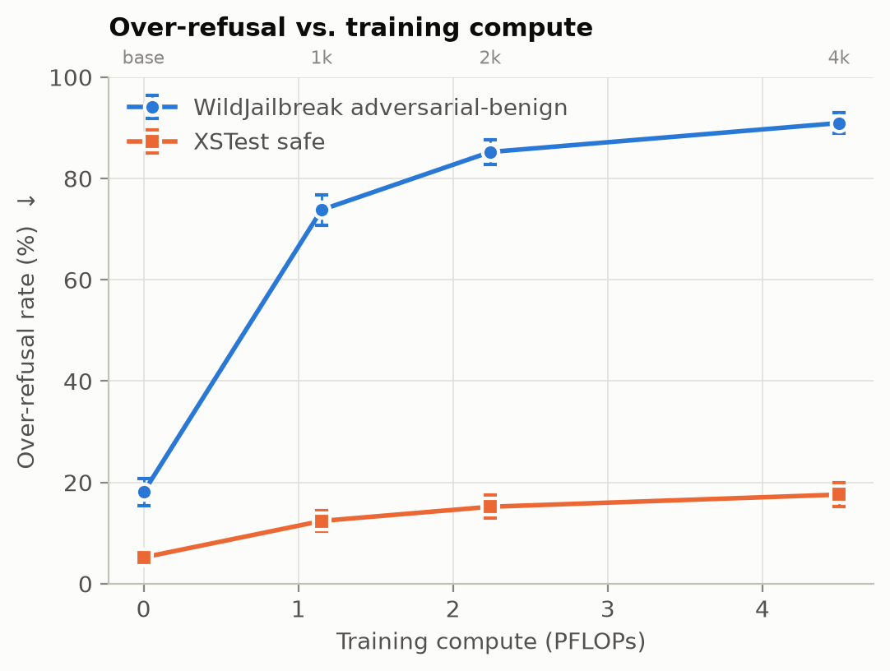
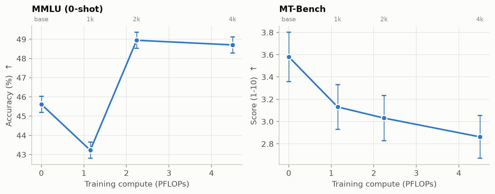

# Soft Prompt Tuning: Method and Experiments

### Method

Soft prompt tuning adapts a frozen language model by learning a small set of continuous input
embeddings instead of updating any model weights. Let $f_\theta$ be a frozen decoder-only language
model with hidden size $d$, and let $E(x) \in \mathbb{R}^{T \times d}$ be the embedded token sequence
of a request $x$ formatted with the model's chat template. We learn a soft prompt
$P \in \mathbb{R}^{n \times d}$ and place it in front of the embedded request:

$$\tilde{x} = [\,P\,;\,E(x)\,] \qquad (1)$$

where $[\,\cdot\,;\,\cdot\,]$ denotes concatenation along the sequence dimension. All model parameters
$\theta$ stay frozen, so $P$ is the only trainable quantity: $n \cdot d = 20 \times 1{,}024 = 20{,}480$
parameters for Qwen3.5-0.8B.

We train $P$ on prompt–response pairs $(x, y)$ in which harmful requests are paired with refusals and
benign requests with helpful answers. The loss is the response-only negative log-likelihood of the
model with the soft prompt prepended,

$$\mathcal{L}(P) = -\,\mathbb{E}_{(x,y)}\Big[\frac{1}{|y|}\sum_{t=1}^{|y|} \log p_\theta\big(y_t \mid P, x, y_{<t}\big)\Big] \qquad (2)$$

which is the same supervised objective used for LoRA and learned steering. Because $P$ enters at the
input, gradients must propagate back through every layer of the frozen network, but no weight
gradients are formed. Following common practice, $P$ is initialized from the token embeddings of a
short instruction, "You are a helpful assistant." At inference time the same learned prompt is
prepended to every request, which adds $n$ input positions and no other cost.

### Experiments

**Setup.** We use Qwen3.5-0.8B with greedy decoding and thinking mode disabled. The training set
contains 4,000 prompt–response pairs from WildJailbreak, balanced across vanilla and adversarial,
harmful and benign requests. Harmful prompts are paired with refusals and benign prompts with
helpful answers. We train for a single epoch with AdamW and save checkpoints after 1,000, 2,000 and
4,000 examples, which serve as three data budgets. Training compute is estimated as
$C \approx 4NT$, where $N$ is the number of parameters involved in each forward pass and $T$ is the
number of processed tokens, including the soft prompt positions. The factor of 4 reflects that only
activation gradients, not weight gradients, are computed for the frozen model. Table 1 lists the
compute of each checkpoint.

| Checkpoint | Examples seen | Tokens processed | Training compute |
|---|---|---|---|
| 1k | 1,000 | ≈0.38M | 1.15 PFLOPs |
| 2k | 2,000 | ≈0.74M | 2.24 PFLOPs |
| 4k | 4,000 | ≈1.49M | 4.50 PFLOPs |

*Table 1: Soft prompt checkpoints. All three come from a single one-epoch run.*

We measure safety by the attack success rate on HarmBench and on the held-out WildJailbreak
evaluation set, whose jailbreaks are unseen during training. Over-refusal is measured on benign
prompts that resemble harmful ones, using XSTest and the benign portion of the WildJailbreak
evaluation set. General capability is measured with MMLU and MT-Bench. Responses are labeled for
refusal and harmfulness by an LLM judge, DeepSeek-V4.1-Flash, which also grades MT-Bench answers.

**Hyperparameter selection.** We compared four configurations on a held-out development split of
WildJailbreak, varying the initialization text, the learning rate and the number of soft tokens.
All four showed the same pattern: a sharp drop in attack success rate together with a rise in
over-refusal, and the differences between them were within noise. We selected the neutral
initialization because it performed best at the smallest budget and does not bias the prompt toward
refusing. Test sets were evaluated only once, after this choice was fixed.

**Results.** Figures 1–3 show how safety, over-refusal and general capability change with training
compute. The leftmost point in each plot is the base model.

*Figure 1: Attack success rate versus training compute. Lower is better.*

*Figure 2: Over-refusal rate on benign prompts versus training compute. Lower is better.*

*Figure 3: MMLU accuracy and MT-Bench score versus training compute. Higher is better.*

As Figure 1 shows, soft prompt tuning is highly effective at blocking harmful requests. With only 20K trainable
parameters, the attack success rate on HarmBench falls from 32% to 7% after the first 1,000
examples and reaches zero at the full budget. The improvement carries over to unseen jailbreaks,
where the attack success rate drops from 42% to 3%. Since HarmBench is drawn from a different
source than the training data, the learned behavior is not confined to the training distribution.

Figure 2 shows that this safety comes at a substantial cost in over-refusal. On benign requests written in a
jailbreak-like style, the refusal rate climbs from 18% to 74% after 1,000 examples and to 91% at the
full budget. On plainly worded benign prompts from XSTest the increase is much smaller, from 5% to
18%. Together with a manual inspection of refused examples, this suggests that the soft prompt
largely learns to refuse based on the surface form of a request, such as role-play framing, rather
than on whether its content is actually harmful. A single prompt prepended to the input appears to
have too little capacity to make this finer distinction.

Most of the change occurs within the first 1,000 examples. Beyond that point the safety gains
saturate while over-refusal continues to grow, so additional compute yields diminishing returns.
As Figure 3 shows, general knowledge is largely preserved: MMLU accuracy stays within a few points of the base model
and moves in both directions, which points to changes in answer formatting rather than in knowledge.
Conversational quality declines moderately, with the MT-Bench score falling from 3.58 to 2.86.
Full numbers are given in Table 2 in the appendix.

**Limitations.** Results come from a single training seed, and the LLM judge has not been validated
against human labels. The compute figures are analytic estimates, and MT-Bench scores from our judge
are not directly comparable to published numbers.

### Appendix

| Model | HarmBench ASR | WJ ASR | XSTest-unsafe ASR | WJ benign over-refusal | XSTest-safe over-refusal | MMLU | MT-Bench |
|---|---|---|---|---|---|---|---|
| Base | 32.0 | 41.8 | 13.0 | 18.1 | 5.2 | 45.6 | 3.58 |
| Soft prompt, 1k | 7.0 | 9.9 | 18.0 | 73.8 | 12.4 | 43.2 | 3.13 |
| Soft prompt, 2k | 0.5 | 4.3 | 16.0 | 85.2 | 15.2 | 48.9 | 3.03 |
| Soft prompt, 4k | 0.0 | 3.0 | 8.5 | 91.0 | 17.6 | 48.7 | 2.86 |

*Table 2: Test results. All values are percentages except MT-Bench, which is scored from 1 to 10.
WJ denotes the WildJailbreak evaluation set. ASR and over-refusal: lower is better; MMLU and
MT-Bench: higher is better.*

