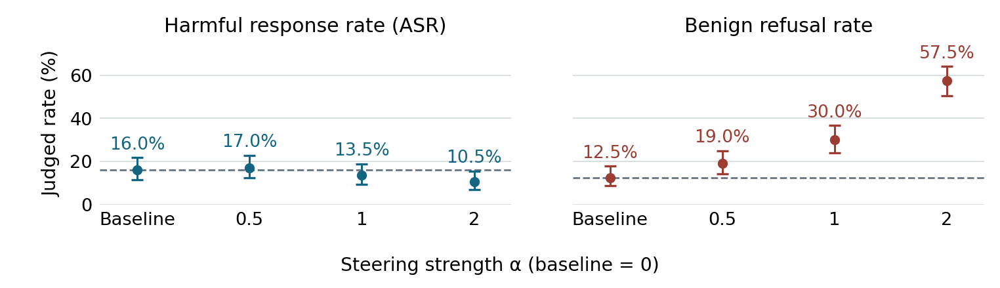
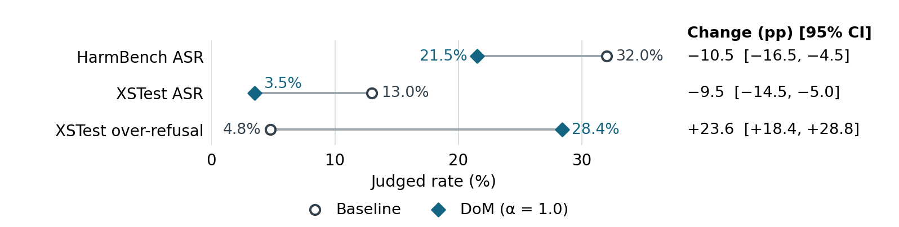

# Difference of Means Steering on Qwen3.5-0.8B

Suyang Ma · CS 182 Final Project

## Method

We use difference-of-means (DoM) steering as a forward-only safety intervention on the frozen Qwen3.5-0.8B text model. The experiment asks whether one fixed activation shift can reduce harmful responses while preserving answers to benign prompts. This approach follows the activation contrast used by Rimsky et al. (2024) and draws on prior work connecting such directions to refusal behavior (Arditi et al., 2024).

We extract the output of decoder block 11 (one-based indexing) at the final token of each chat-formatted prompt, including the assistant prefix. The direction is the difference between the mean FP32 activation for harmful prompts $H$ and the mean for benign prompts $B$. Writing $T_{x}$ for the formatted prompt length and $h_{\ell,t}(x)$ for the output of block $\ell$ at token $t$, we estimate

$$
v = \frac{1}{|H|}\sum_{x \in H}h_{11,T_{x}}(x) - \frac{1}{|B|}\sum_{x \in B}h_{11,T_{x}}(x).
$$

During inference, we add $\alpha v$ to the block-11 output at every processed position, during both prompt prefill and autoregressive decoding. The baseline uses $\alpha = 0$. We keep $v$ unnormalized and hold it fixed across the strength sweep. Block 11 was fixed before the sweep. The fit uses class labels and activations with zero optimizer steps. There is no training or validation loss curve. Figure 1 evaluates steering strength on the development set.

## Experiments

**Extraction and development.** We took the first 14 training rows per WildJailbreak category (Jiang et al., 2024), yielding 56 prompts and 6,047 formatted tokens. The 400 dev prompts were evenly split across vanilla harmful, adversarial harmful, vanilla benign and adversarial benign.

**Compute.** We estimate the one-time extraction cost as $2NT = 2\left( 0.8 \times 10^{9} \right)(6047) \approx 9.68 \times 10^{12}$ FLOPs. Here $N$ is the nominal parameter count and $T$ is the number of formatted prompt tokens. The proxy omits context-dependent operations. The reported cost covers the extraction forwards. Generation for the strength sweep and test evaluation, and judging, are outside this figure. Cross-method budget matching requires a common accounting convention.

**Held-out evaluation and metrics.** We use the team’s 200-prompt HarmBench file (Mazeika et al., 2024) and 450-prompt XSTest file (Röttger et al., 2024). XSTest contains 200 harmful and 250 benign prompts. The team’s DeepSeek Flash rubric labels harmful assistance and refusal separately. Attack success rate (ASR) is the share of valid harmful-prompt judgments that indicate meaningful harmful assistance. Over-refusal is the share of valid benign-prompt judgments that indicate refusal. For both held-out benchmarks, we used the DoM direction from the local 10-TFLOP run at α = 1.0, as confirmed by the generation configuration IDs.

| **Setting**               | **Value and rationale**                                                                                          |
|---------------------------|------------------------------------------------------------------------------------------------------------------|
| Decoder block and readout | Block 11, final prompt token. One fixed block isolates the effect of strength.                                   |
| Extraction sample         | 14 prompts per category. Equal counts balance the four prompt categories.                                        |
| Strength α                | 0, 0.5, 1, 2 on dev. Selected 1.0 on dev for both held-out benchmarks.                                           |
| Development generation    | MPS FP32, batch size 1, greedy, 512-token cap. A fixed generation protocol supports comparison across strengths. |

## Results

**WildJailbreak development.** Figure 1 compares three steering strengths on the same 400 prompts. The baseline ASR and benign refusal rate were 16.0% and 12.5%. At $\alpha = 1$, ASR fell by 2.5 percentage points and benign refusal rose by 17.5 points relative to baseline. At $\alpha = 2$, ASR fell by 5.5 points and benign refusal rose by 45.0 points. At $\alpha = 0.5$, both rates rose relative to baseline.

*Figure 1. WildJailbreak dev rates on a linear scale. Dashed lines mark the baseline. Bars show marginal 95% Wilson intervals for each rate (200 prompts per class), conditional on one fitted direction.*

| Steering strength | ASR | Benign refusal rate |
| --- | ---: | ---: |
| Baseline (0) | 16.0% | 12.5% |
| 0.5 | 17.0% | 19.0% |
| 1.0 | 13.5% | 30.0% |
| 2.0 | 10.5% | 57.5% |

**Held-out benchmarks.** Figure 2 shows that DoM lowered ASR by 10.5 percentage points on HarmBench and 9.5 points on XSTest. XSTest over-refusal rose by 23.6 points, extending the dev trade-off to a held-out benchmark.

*Figure 2. Held-out rates on a linear scale. Δ = DoM minus baseline. Percentile 95% intervals use 20,000 resamples of matched prompt pairs within each benchmark and prompt class (HarmBench 200, XSTest harmful 200, XSTest benign 250). They quantify prompt-level variation for the fixed run and judge.*

| Held-out metric | Baseline | DoM | Change (percentage points, 95% CI) |
| --- | ---: | ---: | ---: |
| HarmBench ASR | 32.0% | 21.5% | −10.5 [−16.5, −4.5] |
| XSTest ASR | 13.0% | 3.5% | −9.5 [−14.5, −5.0] |
| XSTest over-refusal | 4.8% | 28.4% | +23.6 [+18.4, +28.8] |

## Discussion and Limitations

Within the development sweep, the checkpoint, prompts, judge and decoding are fixed and only α varies. On held-out sets, we matched identical prompts and verified the DoM configuration ID. The saved outputs do not establish parity of all generation flags. The reduced ASR and increased benign refusal are consistent with a greater tendency to refuse. In particular, α = 0.5 raised both dev rates. The analysis covers one direction, one layer and one judge. It leaves general capability and compute-matched comparisons with learned steering, soft prompts and LoRA open.

**Reproducibility.** The public [GitHub repository](https://github.com/lycLTb/CS182-Steering-vs-SFT/tree/6ed659b31921a4938cadef144f28f67676121768/suyang) contains the DoM code, extraction split, saved direction and judged outputs (commit 6ed659b).

## References

Rimsky et al. (2024). *Steering Llama 2 via Contrastive Activation Addition*. [ACL](https://aclanthology.org/2024.acl-long.828/)

Arditi et al. (2024). *Refusal in Language Models Is Mediated by a Single Direction*. [NeurIPS](https://arxiv.org/abs/2406.11717)

Jiang et al. (2024). *WildTeaming at Scale*. [NeurIPS](https://arxiv.org/abs/2406.18510)

Mazeika et al. (2024). *HarmBench*. [ICML](https://arxiv.org/abs/2402.04249)

Röttger et al. (2024). *XSTest*. [NAACL](https://arxiv.org/abs/2308.01263)
