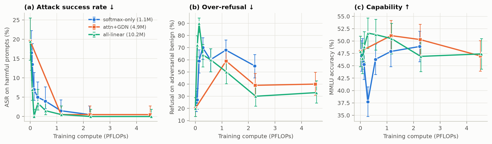
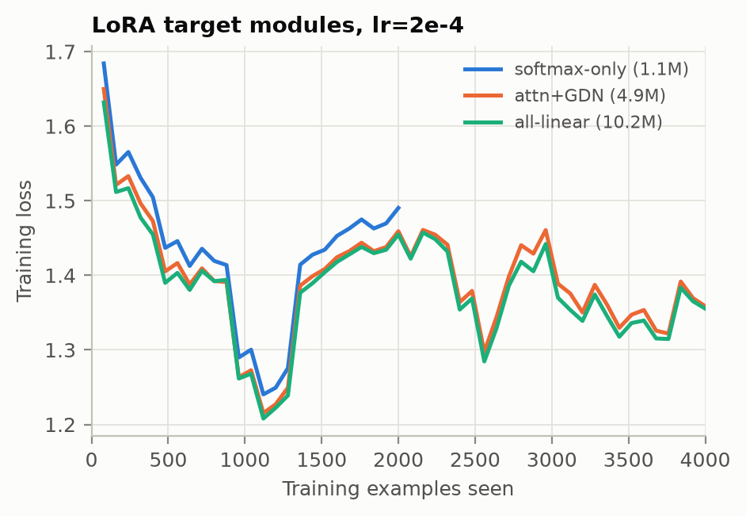

# LoRA SFT — draft sections (Yanchi)

> Draft. `[IN PROGRESS]` marks parts that depend on runs not yet done. `[SHARED]` marks text that should
> move to the common setup section if teammates agree. All numbers below are on the **dev** split.

---

## Related work: LoRA placement in linear-attention and hybrid models

LoRA [Hu et al., 2022] adds a trainable low-rank update to frozen weight matrices. The original paper adapted
only the attention query and value projections. Later work on Transformers found that this is too
restrictive: QLoRA [Dettmers et al., 2023] matches full fine-tuning only when every linear layer is adapted,
and Biderman et al. [2024] and Schulman et al. [2025] report that the MLP blocks matter more than the
attention projections. Adapting "all linear layers" has since become the default.

This guidance does not carry over directly to our model. Qwen3.5-0.8B is a hybrid: 18 of its 24 layers are
Gated DeltaNet (GDN) layers, a linear-attention mixer with a recurrent state, and only 6 use softmax
attention. For state space models, Galim et al. [2025] show that LoRA works on the linear projections
around the recurrent core but not on the recurrent parameters themselves, and that input-side methods such
as prefix tuning are weak because they reduce to tuning the initial state. The closest study to ours is
Borobia et al. [2026], who compare LoRA placements on the same model, Qwen3.5-0.8B, with the same rank and
learning rate. On math, code and chat fine-tuning they find that adapting only the 6 softmax-attention
layers works best, and that adapting the GDN layers or adding the MLP blocks hurts. Their tasks, schedule
(3 epochs, cosine) and evaluation differ from ours, so we test their recommendation on safety tuning
(Section X.3).

---

## Method

**Supervised fine-tuning.** We fine-tune on prompt–response pairs with the standard SFT objective: the
token-level cross-entropy of the response given the prompt, with prompt tokens masked out. Training data and
order are identical to those used for the soft prompt.

**LoRA.** Full-parameter fine-tuning does not fit in our 12 GB of GPU memory, so we use LoRA. For a frozen
weight $W \in \mathbb{R}^{d_\text{out} \times d_\text{in}}$, LoRA learns
$$W' = W + \tfrac{\alpha}{r} BA, \qquad B \in \mathbb{R}^{d_\text{out}\times r},\; A \in \mathbb{R}^{r \times d_\text{in}},$$
with $B$ initialized to zero, so training starts from the base model. We use $r = 16$, $\alpha = 32$. After
training, $BA$ is merged into $W$, so inference cost is unchanged.

**Where to apply LoRA.** We compare three placements (Table 1). Following Borobia et al. [2026], we name them
by component type. We exclude the GDN gate projections, whose 16-dimensional outputs are no larger than the
rank, the short convolutions, and the embedding matrix, which is tied to the output head. Unless stated
otherwise we use **all-linear**, the best placement in Section X.3.

*Table 1: LoRA placements.*

| Name | Adapted matrices | Trainable params |
|---|---|---|
| softmax-only | Q, K, V, O projections of the 6 softmax-attention layers | 1.1M |
| attn+GDN | + input (QKV, gate) and output projections of the 18 GDN layers | 4.9M |
| all-linear | + gate, up and down projections of the MLP in all 24 layers | 10.2M |

**Budgets from a single run.** `[SHARED]` After a 20-step linear warmup the learning rate is held constant.
With a constant rate, the checkpoint saved after $N$ examples is exactly the model a run stopped at $N$
would produce. One run therefore yields every budget. We save checkpoints at 64, 128, 256, 512, 1000, 2000
and 4000 examples. The small budgets were added because the attack success rate already saturates by 1000
examples. The 64- and 128-example checkpoints fall inside the warmup.

**Compute.** `[SHARED]` We report training compute in FLOPs, computed from the tokens actually processed.
Frozen weights cost $4N$ FLOPs per token (forward plus activation gradients), trainable weights $6N$. For LoRA,
$C \approx 4NT + 6N_\text{LoRA}T$, where $N$ is the number of weights used in each forward pass and $T$ the
number of tokens. The LoRA term adds about 1% over the soft prompt at the same number of examples.

---

## Experiments

### X.1 Setup
`[SHARED]` Model, data, benchmarks, judge and decoding settings are given in Section Y. Hyperparameters and
placements are chosen on the dev split (400 prompts, 100 for each of vanilla/adversarial × harmful/benign).
The test sets are evaluated once, after all choices are fixed. Error bars are 95% Wilson score intervals.
We use these instead of ±1 SE because several rates are near 0%, where the normal approximation breaks down.

### X.2 Learning rate
The learning rate is the only optimizer hyperparameter we tune. We swept six values, roughly evenly
spaced on a log scale, using the attn+GDN placement. We kept configurations with dev ASR ≤ 5% and MMLU
no more than 3 points below the base model (≈2 standard errors at n = 1000). Among those, we chose the one
with the lowest over-refusal. The MMLU threshold was added after seeing the 5e-4 and 1e-3 results.

*Table 2: Learning-rate sweep (attn+GDN, dev). Each cell gives 2000 / 4000 examples. Base: ASR 19.5,
adversarial-benign refusal 20, MMLU 47.9.*

| lr | ASR (%) | Adv.-benign refusal (%) | MMLU (%) |
|---|---|---|---|
| 2e-5 | 3.5 / 2.0 | 55 / 50 | 50.3 / 50.4 |
| 5e-5 | 1.5 / 0.0 | 55 / 49 | 51.4 / 51.8 |
| 1e-4 | 0.0 / 0.5 | 53 / 51 | 51.5 / 50.1 |
| **2e-4** | 0.5 / 0.5 | **39 / 40** | 50.3 / 47.0 |
| 5e-4 | 1.0 / 0.0 | 32 / 33 | 47.6 / 42.7 |
| 1e-3 | 0.0 / 0.0 | 47 / 40 | 36.9 / 27.6 |

Every learning rate removes most attacks. They differ in over-refusal and capability. Contrary to our
expectation, smaller learning rates give *more* over-refusal, not less. Above 2e-4, MMLU drops; at 1e-3
it falls to near chance (25%). We use 2e-4.

`[IN PROGRESS]` The sweep used the attn+GDN placement, but our final placement is all-linear. We will
repeat the sweep on all-linear.

### X.3 Where to apply LoRA
Figure 1 compares the three placements across budgets. All use lr 2e-4 and see the same data in the same
order, so each budget is a paired comparison.

*Figure 1: Dev results vs. training compute for three LoRA placements. (a) Attack success rate on harmful
prompts (n = 200). (b) Refusal rate on adversarial benign prompts (n = 100), the category where over-refusal
concentrates. (c) MMLU accuracy (n = 1000). The point at 0 PFLOPs is the base model. Error bars are 95%
Wilson intervals over evaluation prompts, i.e. the sampling error of the finite evaluation set. Each
configuration was trained once, so seed variance is not included. `[IN PROGRESS]` attn+GDN has so far been
evaluated only at 1000, 2000 and 4000 examples; its segment from the base model to 1000 examples is not
measured.*

Unlike on Borobia et al.'s tasks, softmax-only is the *worst* placement for safety tuning. At 2000 examples
all three reach near-zero ASR, but adversarial-benign refusal is 55% for softmax-only, 39% for attn+GDN and
30% for all-linear. Softmax-only also removes attacks more slowly: at 64 examples its ASR is 13.5%, against
7.0% for all-linear. Adding the MLP blocks costs about 1% more compute and does not reduce MMLU beyond noise.
We therefore use all-linear.

Two caveats apply. The learning rate was tuned for attn+GDN. Softmax-only has a fifth of its parameters
and may need a larger rate, so this comparison may understate it. Each configuration was also run with a
single seed.

### X.4 Results
`[IN PROGRESS]` Test-set results (HarmBench, WildJailbreak, XSTest, MMLU, MT-Bench) for the final
configuration, plotted with the other methods in the shared figure.

On dev, three patterns stand out (Figure 1).

1. **Safety is cheap.** All-linear LoRA cuts ASR from 19.5% to 0% within 128 examples (0.14 PFLOPs).
   Additional compute does not improve ASR further.
2. **Over-refusal first rises, then falls.** Refusal on adversarial benign prompts jumps from 20% to 90%
   at 128 examples, then declines to about 30% by 2000 examples. Refusal on vanilla benign prompts is
   smaller and also transient: 20% at 64 examples and 24% at 512, back to 4–6% from 2000 examples on
   (base 6%). The model first learns to refuse anything wrapped in a role-play or jailbreak-style framing,
   and only with more data learns to tell harmful from benign content inside that framing. Most of the
   extra training budget therefore goes to reducing over-refusal, not to improving safety.
3. **Refusals collapse to a fixed phrase.** From 128 examples on, the median refusal is 44–48 characters,
   a single sentence such as "I'm sorry, but I can't assist with that request." The training refusals are much longer and more
   varied (median ≈1000 characters).

Figure 2 shows the training loss. Training runs for one epoch, so every batch is unseen when its loss is
computed, and the training loss doubles as a held-out loss. All runs see identical batches, so the shared
spikes reflect batch content. The gap between curves is a paired difference. Loss differences between
placements are small (mean over steps 10–250: 1.42 softmax-only, 1.40 attn+GDN, 1.39 all-linear), even
though their over-refusal differs clearly.

*Figure 2: Training loss for the three LoRA target-module configurations at lr 2e-4 (one batch of 8 logged
every 10 steps, 5-point moving average).*

### X.5 Limitations
- One seed per configuration, so seed-to-seed variance is not measured; the error bars cover only
  evaluation-set sampling error. Dev has 100 prompts per category, so differences under about 10 points in a
  single category are not resolved.
- The learning rate was selected on a different placement than the final one (re-sweep in progress), and the
  MMLU threshold in the selection rule was set after seeing results.
- LoRA was tuned over more configurations than the soft prompt (6 learning rates and 3 placements, against
  4 configurations).
- The LLM judge has not been validated against human labels. It labels refusal and harmfulness in one call
  with reasoning disabled. In a separate test, a judge with reasoning disabled showed a position bias on
  XSTest-style labels.
- For softmax-only, gradients need not flow below the first adapted layer (layer 3). Its true backward cost is
  therefore about 6% below the reported FLOPs.
